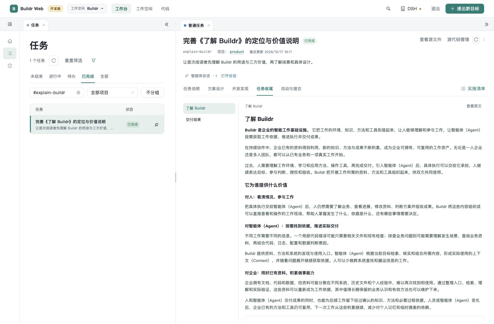

# Buildr

中文 | [English](README.en.md) | [开始使用](#开始使用) | [文档](docs/README.md)

**Buildr 是企业的智能工作基础设施。** 它把工作的环境、知识、方法和工具衔接起来，让人看清情况、参与判断，让智能体（Agent）按需找到依据、推进交付，让企业用好已有资料，把经过确认的知识、方法和成果积累为可拥有、可复用的工作资产（Work Asset）。

你继续使用熟悉的智能体（Agent）工具，从讨论想法和方案，持续推进到实现、验证与交付。Buildr 为各阶段组织可发现、可复用的工作依据；人表达目标、参与判断、提供授权并验收成果。无论是一人企业还是多人团队，都可以从已有业务和一项真实工作开始。

## Buildr 有什么用

业务资料分散，前后端代码的关系不清，开始一项工作就要重新解释背景；有效方法留在个人经验或聊天里，换个参与者或智能体（Agent）工具，又要重新整理。Buildr 帮助你用好已有积累，让后续工作有共同依据。

| 对谁 | 带来什么 |
| --- | --- |
| 人 | 查看资料、进展和实际成果，参与判断与直接修改，减少跨系统查找和搬运信息 |
| 智能体（Agent） | 按目标发现资料、方法与系统入口，核实当前情况，持续推进工作 |
| 企业 | 把经过确认的知识和有效方法维护为可拥有、可共享、可复用的工作资产（Work Asset），减少对个人记忆和临时摸索的依赖 |

例如，你可以从这些实际工作开始：

- **把已有业务和代码接起来。** “业务文档、前端和后端代码分散在不同位置，请帮我梳理它们的关系。”产品人员维护业务目标和约束，设计、开发、测试人员及其智能体（Agent）从同一份当前资料继续工作。
- **排查并修复问题。** “这笔订单已经支付成功，页面为什么还显示待支付？”在相关资料和系统已接入时，智能体（Agent）沿线索查文档、代码、日志、配置和数据，定位原因、修复并验证；你查看依据、参与判断并验收结果。
- **留下方法，接着做。** “把这次验证有效的处理方法留下来；下次从已有成果继续。”中断或切换工具后，智能体（Agent）重新读取目标、方法和实际改动，核对现状后接续；值得复用的经验经过确认再维护下来。

## Buildr 怎样组织工作

### 用共同的工作范围连接资料与代码

工作空间（Workspace）是人和智能体（Agent）共同工作的目录与发现入口。项目（Project）说明业务目标和约束，服务（Service）说明实现职责，代码库（Repository）关联实际代码来源与位置，让双方从“要做什么”找到“在哪里做”。没有代码的工作也可以先从资料开始。

### 围绕目标保留进展与实际成果

任务（Task）保留具体工作的目标、进展和成果位置，可以关联多个会话（Session）。人在 Buildr 中阅读知识、修改文件、查看代码改动与提交；智能体（Agent）依据同一来源及当前工具结果开展工作。代码、文档和业务数据留在各自所属位置，接续时重新核对当前成果。

*截图来自 Buildr 开发版，展示自身开发中的真实工作。*

### 复用工作事实、工作方法和系统入口

长期维护的工作资产（Work Asset）主要包括**工作事实**和**工作方法**：前者说明业务约束、项目（Project）组成等当前情况，后者说明怎样执行、检查和交付。规则（Rule）表达边界，技能（Skill）保存可复用的方法。

连接把方法与具体系统衔接起来。当前提供 MySQL、Kibana、Nacos 和 XXL-JOB 的可选接入方法，也支持制作企业自己的接入方法；具体操作由配置、权限、专业方法及授权共同决定。资料、查询结果或新成果经过判断和确认，才将值得长期复用的部分纳入维护。

### 接入熟悉的智能体（Agent）工具

Buildr 当前支持 Codex、DSH 的接入与原生会话（Session）关联，按工具适配方式准备必要的规则（Rule）和技能（Skill）入口；项目（Project）资料与代码继续从原处读取。智能体（Agent）负责理解目标、选择依据、推理和执行，Buildr 组织长期资料、方法与使用入口。

## 开始使用

官方包名为 `@buildr-ai/buildr`，当前支持 macOS 和 Windows，可通过启动器（Launcher）或浏览器使用。普通使用无需克隆本仓库，也无需先学习命令。

### 1. 安装 Buildr

在能操作本机文件和执行命令的智能体（Agent）工具中，例如 Codex、DSH，把下面这段话交给它：

> 请参考 https://github.com/BuildrAI/Buildr 帮我安装 Buildr 和启动器（Launcher）。

智能体（Agent）负责检查环境和安装。安装和手动恢复细节见[安装参考](projects/product/services/buildr/docs/cli-reference.md#首次使用)。

### 2. 选择目录并初始化工作空间（Workspace）

安装完成后，选择一个目录，用来组织你的业务资料、工作方法和代码关联。可以使用已有目录，也可以新建目录。在智能体（Agent）工具中打开所选目录；已有工作空间（Workspace）先核对现状并接续，不重复初始化。

如果所选目录尚未初始化，告诉智能体（Agent）：

> 请将当前目录初始化为 Buildr 工作空间（Workspace），然后打开 Buildr。

普通初始化会将该目录默认登记到本机 Buildr Web，无需再手动添加。此前已初始化但未登记的工作空间（Workspace），可在选择页用“添加已有工作空间”加入列表。

### 3. 在 Buildr Web 中配置工作范围

在 Buildr Web 中进入该工作空间（Workspace）；若显示选择页，先从列表选中它。在“项目”页面先查看已有项目（Project），按需选用；需要新增时点击“新增项目”，填写业务目标与约束，已有项目目录则可选择“登记已有项目”。

有代码的工作，再在“服务”和“代码库”页面登记实现职责与实际代码位置，将相关服务（Service）关联到项目（Project）。按当前需要配置即可，没有代码的工作可以先只建立项目（Project）。

### 4. 开始第一项真实工作

确认 Buildr 显示的是目标工作空间（Workspace），相关资料和需要的代码位置正确，智能体（Agent）工具打开的是**同一个目录**，并能使用适用方法。然后提出具体目标，例如：

> 为订单列表增加按状态筛选，沿用现有界面和测试方式。完成后说明改动、验证结果和仍未解决的问题，并更新受影响的资料。

在 Buildr 中查看已登记的任务（Task）、进展和成果，参与需要判断的事项。中断后，提供原任务（Task）或成果位置，让智能体（Agent）读取当前情况继续；工作完成后说“收尾”，由它完成已授权的交付与整理。

### 以后如何更新

在要更新的工作空间（Workspace）目录中告诉智能体（Agent）：

> 更新 Buildr 和当前工作空间（Workspace），保留已有资料与本机记录。

更新 Buildr 会同时更新包内的 Buildr Web，并自动将同一安装中正在运行的旧版切换到新版，无需重新打开启动器（Launcher）。切换时网页会短暂中断。工作空间（Workspace）还需同步适用的工作资产（Work Asset）和当前智能体（Agent）入口。完成后，由智能体（Agent）说明产品版本、Buildr Web 是否已切换，以及工作空间（Workspace）的更新结果。

日常使用、更新和恢复见[使用指南](projects/product/knowledge/docs/guides/getting-started.md)，更新前需要了解的数据保护见[更新与数据保护](projects/product/knowledge/docs/guides/getting-started.md#更新与数据保护)。

Buildr 当前以本机工作为主。文件资料可以通过 Git 共享，任务（Task）等本机记录不会自动跨机器同步；目前没有完整企业权限或云端协作能力。修改完成、检查通过和上线生效分别依据实际结果确认，详见[当前使用边界](projects/product/services/buildr/docs/known-limitations.md)。

## 进一步了解

- [了解 Buildr](projects/product/knowledge/docs/overview.md)：产品用途、协作方式与后续方向。
- [工作对象与代码关系](projects/product/knowledge/docs/architecture/project-service-repositories.md) · [从讨论到交付](projects/product/knowledge/docs/architecture/task-system.md)：理解工作怎样组织和接续。
- [技能（Skill）体系](projects/product/knowledge/docs/architecture/buildr-skill-system.md) · [外部系统连接](projects/product/knowledge/docs/architecture/external-connections.md) · [智能体（Agent）工具适配](projects/product/services/buildr/docs/agent-runtime-adapters.md)：按需了解方法复用与工具接入。
- [文档目录](docs/README.md)：查找更多使用、设计与技术说明。

## 用 Buildr 开发 Buildr

**本仓库就是一个自举工作空间（Self-Bootstrapping Workspace）。** Buildr 用自身组织产品资料、工作方法和研发工作。`projects/product/` 保存产品知识、设计与规范，并关联实际实现；你可以从这个真实案例了解它怎样用于日常开发。

想参与开发，在智能体（Agent）工具中打开本仓库根目录，告诉它：

> 我想参与 Buildr 开发，请阅读仓库规则和产品开发说明，准备开发环境。

这是已有的工作空间（Workspace），无需重新初始化。开发使用仓库内的 `projects/product/buildr` 入口；实现组成、环境准备和检查方式从[产品开发入口](projects/product/README.md)继续阅读，贡献方式见[贡献指南](CONTRIBUTING.md)。

[反馈问题](https://github.com/BuildrAI/Buildr/issues) · [安全报告](SECURITY.md) · [MIT 许可证（License）](LICENSE)
