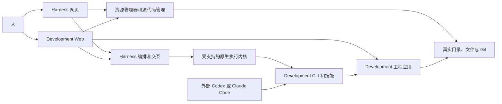

# Buildr Harness 与 Development：产品、代码与发行边界

本页解释 **Buildr Harness 的目录级工作环境**与 **Buildr Development 的软件工程开发套件**，区分产品责任、实际源码和发行形态，不代替规范、验证或发布证据。

## 产品关系

| 产品 | 权责 | 典型入口 |
| --- | --- | --- |
| Buildr Harness | 原生执行内核接入、模型账号和来源、自己的编排与交互、对话和执行控制，以及目录级文件和 Git 工作环境 | 独立 Harness 网页和 CLI；也可向其他产品提供明确的组合入口 |
| Buildr Development | 软件工程的组织、知识、任务、验证和交付。它解析已登记范围，分配、关联并安全回收任务的 Git 工作树 | CLI 和技能可脱离网页与 Harness 使用；Development Web 可同页装配 Harness 并增加工程能力 |

图中从执行内核到 CLI 的箭头表示智能体可在已准备的工程工作空间选择调用 CLI，并非所有对话都要求 Development。原生 Codex/Claude Code 可以独立消费该 CLI；人可只用 Harness 完成本地修改、审阅和本地提交，不需要创设工程任务。原生内核保有推理循环与工具权限；模型接入允许用户按实际支持选择原生账号、订阅或自带密钥（BYOK），不承诺所有内核与账号任意组合。

两种入口可能称工作范围为“工作空间”。独立目录只保存明确选择的本机目录和身份，不创建 Development 工程登记；工程宿主继续维护项目、服务、仓库和任务的关系。任务工作树是普通 Git 工作树：Harness 可以在明确获准的检出目录里工作；为任务创建、关联和安全清理工作树仍由 Development 组织。

## 四个实现目录

- `services/buildr-harness/`：原生执行接入、编排与私有交互、目录宿主；`@buildr-ai/buildr-harness/workbench` 提供无执行后台依赖的文件和 Git 通用能力。
- `services/buildr-harness-web/`：唯一完整对话实现及独立网页；`explorer.ts` 和 `source-control.ts` 分别公开资源管理器与源代码管理视图。
- `services/buildr/`：Development CLI、工程应用、工作范围解析、资源和发行；使用共享文件/Git 底层实现，保留工程接口和副作用边界。
- `services/buildr-web/`：Development 工程页面。`harness-ui` 装配对话；工程代码入口装配 Harness 的视图并补充多仓库、任务深链、项目文件、发布和同步相关操作。

实现定位见[双产品代码地图](../../code-map/harness-products.md)。

## 网页组合与实际操作

独立 Harness 的对话右侧是可收起的工作区，从对话标题行右侧打开；工作区首页提供“资源管理器”和“源代码管理”，两个模块可同时打开为标签并独立切换或关闭。“＋”在标签下方打开同一首页，点击已打开的模块会激活其原标签。切换对话工作空间时，标签保留，文件与 Git 内容随之切换。两者可独立装配；在对话中共用其工作空间解析出的目录，已有的本机目录或 Development 工作空间不需要重复登记。新对话选定范围后也能先浏览，再决定是否发送消息。普通目录可以浏览、搜索、打开和保存文件；Git 操作要求明确选中工作树根。上级仓库、关联检出和任务旧路径不作为自动回退；选定浏览来源不会改变对话的执行位置。用户或智能体通过原生工具修改文件后，网页可刷新真实内容；写入重核实际位置、文件和已观察的版本，冲突保留草稿。智能体继续使用现有文件工具和原生 Git；不需要通过新的网页私有接口工作。

源代码管理显示实际变更层、差异与固定提交历史。独立入口显式暂存、取消暂存和本地提交，提交只包含已核对的暂存内容，不自动推送；存在未完 Git 操作、未核对的范围或需要执行提交钩子时保留现场并说明原生 Git 路径。工程同步、任务关联及交付仍在 Development 原入口处理，不迁移其记录或权限。

Development 通过 `conversation.ts` 接入完整对话，并分别装配共享文件与 Git 视图；第一方组合使用同一 React 页面树，而不是另建对话或文件差异实现。任务、文件深链和工程操作通过明确适配器提供，复核工程范围而不自动切换到独立目录。独立网页的兼容文件预览和 Development 原路由保持。可选工作环境的故障局部呈现；可信的同页装配不构成不可信插件的安全沙箱。

## 核心与数据兼容

包与源码改名不迁移 `agent-service` 的已有数据根、账号、对话库及控制脚本路径。相同用户、配置域和准确数据根可复用同一逻辑后台；开发、发布和隔离预览不隐式混用。关闭或卸载入口不删除共享历史与账号。原生程序仍拥有其推理循环；Harness 统一接入与控制，不自研另一套循环。

## 发行内容

Harness 本机包携带编译核心、CLI、启动器、完整网页、运行依赖和许可证据；不含 Development 工程业务、用户账号或工作空间私人资料。Development 主包 `@buildr-ai/buildr` 携带工程实现与网页、工程资源，并携带所用 Harness 运行负载及完整网页，无需用户手动先装另一份独立 CLI。

Node 最低要求仍为 `24.15.0`；原生程序管理、真实模型账号和使用权是各自边界，不因制包成功自动取得。Harness 独立包当前仍 `private:true`，本机验收包不是正式公开发布旁路；许可证据和平台批准不能代填。Windows 实测不在本轮范围。

## DSH 插件组合

DSH 是一个可选的生态宿主，也可以是 Harness 选择的原生执行入口；这两种角色不同。插件可以组合 Harness、Development 或其他开发者提供的工作台。插件接入不复制对话/任务权威，不把两套编排同时施加给同一执行；现有 `dsh-plugin` 服务独立维护，分别提供插件是产品方向，不声称已实现或发行新的插件组合。

既有拆分规范见[产品边界](../../../openspec/specs/harness-product/spec.md)、[网页装配](../../../openspec/specs/harness-web-composition/spec.md)和[独立发行](../../../openspec/specs/harness-independent-distribution/spec.md)；目录工作台和共享视图的本次演进见[工作台变更](../../../openspec/changes/archive/2026-11-20-harness-directory-workbench/proposal.md)。本页描述当前源码能力，不把候选实现当作所有渠道已交付。

## 独立网页端口

独立 Harness CLI 和启动器默认按配置域使用固定端口：开发版 `9519`，发布版 `9518`；`web --port <端口>` 可显式覆盖。Development 自身的端口与入口保持不变。已有独立网页地址不同，启动命令通过第一方管理接口核对端点与代次后安全换绑；新端口被占用时保持原地址并报错，不抢占或停止Agent执行。换绑撤销旧页面登录，需从启动器重新打开；账号、历史和执行仍保留原数据域。旧地址下未发送草稿仍留在原浏览器origin，不自动搬迁。

页面会话从启动器票据兑换后按认证活动滑动续期，不活动窗口 30 天；兼容重启或更新保留会话，同一浏览器刷新页面即可恢复访问，文档加载会按服务端剩余寿命同步刷新 Cookie。超过不活动窗口、显式登出或换绑撤销后，才需要重新从启动器打开。
