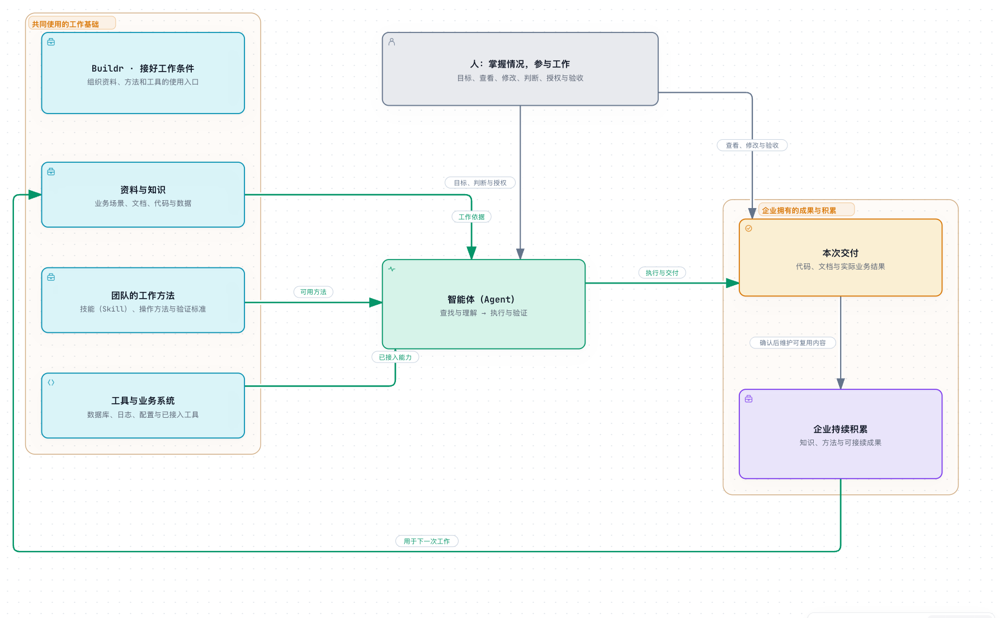

# 了解 Buildr

**Buildr 是企业的智能工作基础设施。** 它把工作的环境、知识、方法和工具衔接起来，让人能够理解和参与工作，让智能体（Agent）按需获取工作依据、推进执行并交付成果。

在持续协作中，企业已有的资料得到利用，新的知识、方法与成果不断积累，成为企业可拥有、可复用的工作资产。无论是一人企业还是多人团队，都可以从已有业务和一项真实工作开始。

过去，人需要理解工作环境、学习和应用方法、操作工具，再完成交付。引入智能体（Agent）后，具体执行可以交给它承担，人继续表达目标、参与判断、授权和验收。Buildr 把开展工作所需的资料、方法和工具组织起来，供双方共同使用。

## 它为谁提供什么价值

### 对人：看清情况，参与工作

把具体执行交给智能体（Agent）后，人仍然需要了解业务、查看进展、修改资料、判断方案并验收成果。Buildr 将这些内容组织成可以直接查看和操作的工作现场，帮助人掌握发生了什么、依据是什么、还有哪些事情需要决定。

### 对智能体（Agent）：按需找到依据，推进实际交付

不同工作需要不同的信息。一个局部代码错误可能只需要相关文件和现有检查；排查业务问题则可能需要理解发生场景、查阅业务资料，再结合代码、日志、配置和数据判断原因。

Buildr 提供资料、方法和系统的发现与使用入口。智能体（Agent）根据当前目标检索、核实和组合所需内容，形成实际使用的上下文（Context），并随着问题展开继续获取依据。人可以少做跨系统查找和搬运信息的工作。

### 对企业：用好已有资料，积累做事能力

企业拥有文档、代码和数据，但资料可能分散在不同系统、历史文件和个人经验中，难以再次找到和使用。通过整理入口、检索、理解和实际验证，这些资料可以重新成为工作依据，其中值得长期保留的业务认识和有效方法也可以维护下来。

人和智能体（Agent）交付成果的同时，也能为后续工作留下经过确认的知识、方法和必要过程依据。人员或智能体（Agent）变化后，企业已有的方法和工具仍可复用，下一次工作从这些积累继续，减少对个人记忆和临时摸索的依赖。

Buildr 把资料、团队方法和系统入口衔接起来，供人和智能体（Agent）按需使用；工作交付后，值得复用的知识与方法继续用于下一次工作。[查看交互图](../archify/system/buildr-work-collaboration.html)。

## 例如：排查一个生产问题

假设你提出：“这笔订单已经支付成功，页面为什么还显示待支付？请排查并修复。”在相关资料、方法和系统接入已经准备好的情况下，智能体（Agent）可以围绕这个目标持续推进：

1. **理解问题。** 根据发生环境、页面和订单信息，查阅业务资料，找到相关代码与处理逻辑。
2. **查找依据。** 按需要检索日志、读取配置、查询业务数据；发现新的线索后，继续使用已接入的相关系统核实原因。
3. **修复与验证。** 根据真实原因修改代码，执行适用检查，说明结果与未覆盖范围；涉及业务取舍时请人判断。
4. **交付与积累。** 按已有授权交付成果。需要上线时，依据团队已经接入的发布方法，在相应授权范围内执行；将值得复用的问题原因、业务知识和处理方法维护下来。

人可以查看依据、参与判断并验收成果；智能体（Agent）按线索获取信息和执行；企业得到修复成果，并留下可供下一次使用的积累。修改完成、检查通过和上线生效分别依据实际结果确认。

## Buildr 怎样组织工作

### 用共同的工作范围连接资料与代码

工作空间（Workspace）组织相关项目（Project）、资料、方法与系统入口。项目（Project）说明业务目标，服务（Service）说明实现职责，代码库（Repository）登记实际使用的代码来源与位置。这些关系帮助人和智能体（Agent）从“要做什么”找到“在哪里做”，详见[工作对象与代码关系](architecture/project-service-repositories.md)。

### 围绕任务（Task）保留目标、进展与成果

任务（Task）承载具体工作的目标、说明、进展和结果，会话（Session）提供沟通与执行入口。同一任务（Task）可以关联多个会话（Session）；切换对话或参与者后，重新读取任务（Task）和实际成果，就能核对当前情况并继续推进。详细说明见[从讨论到交付](architecture/task-system.md)。

### 让人和智能体（Agent）面对同一份实际成果

人在 Buildr 中查看项目（Project）组成、阅读知识、浏览和修改文件，通过源代码管理（Source Control）检查改动与提交，也可以使用 MySQL 查询工具查看数据。智能体（Agent）结合相同来源及当前工具结果开展工作，修改后保留可以查看、检查和接续的成果。代码、文档和业务数据仍保存在各自所属位置。

### 让工作方法与系统接入可以复用

值得长期维护的资产主要包括**工作事实**和**工作方法**：前者说明业务约束、项目（Project）组成等当前事实，后者说明怎样执行、检查和交付。规则（Rule）表达边界，技能（Skill）保存可以复用的方法；经过判断和确认、值得复用的经验再沉淀为长期知识与方法。

连接把这些方法与具体系统衔接起来。当前提供 MySQL、Kibana、Nacos 和 XXL-JOB 的可选接入方法，也支持制作企业自己的接入方法。配置、账号、专业方法及具体授权共同决定实际可执行的动作。相关说明见[技能体系](architecture/buildr-skill-system.md)和[外部系统连接](architecture/external-connections.md)。

### 接入熟悉的智能体（Agent）工具

你继续使用熟悉的智能体（Agent）工具，从一句自然语言目标开始，让它协助准备工作环境并进入任务（Task）。Buildr 组织长期资料和发现入口，并按适配方式将规则（Rule）、技能（Skill）准备到工具可使用的位置。智能体（Agent）负责理解目标、选择信息、形成工作依据和推进执行。也可以在 Buildr 的全局“对话”入口使用独立配置的 Codex、DSH 或 Qoder，围绕同一段对话持续执行，并按需要关联任务（Task）。历史按对话组织，各执行方分别保有原生上下文；切换参与者仍要重读当前成果。内部对话、一次生成和外部会话关联的边界见[智能体接入](architecture/agent-integration.md)。

[系统全景图](../archify/system/buildr-system-overview.html)展示主要组成与职责；不熟悉的概念可以查[术语表](glossary.md)。

## 当前边界

Buildr 当前以本机工作为主。文件资料可以通过 Git 共享，任务（Task）等本机记录不会自动跨机器同步；目前没有完整企业权限或云端协作能力。具体工作由所选智能体（Agent）及实际系统执行；内部对话在本机私有库保存统一可见记录，各家独立配置保存原生上下文，外部桌面对话继续由原工具保存。内部对话是当前候选实现，发布及各环境采用情况仍需分别确认；不承诺桌面应用全部功能。

资料可被发现后，仍需按目标重新读取、核实和选择；文件位于工作空间（Workspace）或一次查询得到结果，都不意味着它已经成为长期受管资产。当前连接各有专业操作范围，生产变更按目标、权限和授权执行；实际接入范围见[外部系统连接](architecture/external-connections.md)。

安装与更新、资料共享及本机记录保护见[开始使用](guides/getting-started.md#更新与数据保护)。工具适配与更多使用条件见[适配参考](../../services/buildr/docs/agent-runtime-adapters.md)和[已知限制](../../services/buildr/docs/known-limitations.md)。

## 接下来读什么

- [开始使用](guides/getting-started.md)：完成安装、必要配置并开始第一项工作。
- [工作对象与代码关系](architecture/project-service-repositories.md)：判断怎样组织项目（Project）与实现、共享和修改会影响哪里。
- [阅读目录](README.md)：按需查找协作方式、技术说明和故障参考。准备开发 Buildr 时，从[技术架构](architecture/technical.md)进入。

本页结合[产品定位规范](../../openspec/specs/agent-first-product-positioning/spec.md)、[核心规则](../../services/buildr/resources/workspace/AGENTS.md)及上述专项说明，解释当前产品的用途、协作方式和使用边界；具体行为以正式规范与实际实现为准。

## 后续方向

近期继续改善开始工作、查找资料、使用连接、交付成果和中断接续的体验。跨工作空间（Workspace）协作、更多系统与智能体（Agent）接入、工作资产（Work Asset）独立分发，都是按真实需求评估的方向，尚不代表已提供能力或版本排期。

每项建设应从一个具体问题出发，证明它能减少重复解释、搬运、核对或人工介入，并说明完成标准与失败影响。已有工具能够可靠承担的执行与调度继续交给它们；Buildr 聚焦共同依据和必要边界。具体实现以正式规范和当次确认范围为准。
