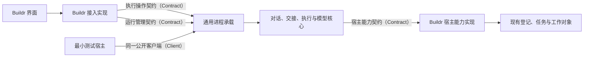
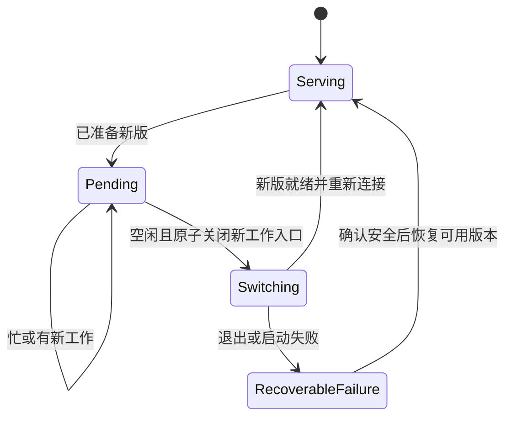

## Context

动机与范围见 [proposal.md](proposal.md)，整体需求见[任务说明](@task/agent-process-isolation)。本材料指导本轮进程独立化候选实现，尚未激活到保留环境。实施前已同步产品仓库 `dev` 至 `b77f586688b2a58bdef3b6542eae361828431527`，冻结前再快进到 `2b88ffe3dd876f44316c38e8748f1fd6f75a8426`（仅发布版本准备），下列源码路径均相对 `projects/product/`。

当前 `services/buildr-agent/src/index.ts` 装配对话、账号、模型转接及私有交互库。生产代码未直接导入 Buildr 内部模块；现有 `AgentServiceOptions` 通过 `resolveWorkspace`、`assertTask` 注入宿主（Host）能力，但仍要求 Buildr 的对象语义。`services/buildr/src/modules/agent-service/module.ts` 提供这些实现并直接持有服务；`src/bootstrap/runtime.ts` 将其关闭绑在主程序退出上。网页操作及数据声明位于 Buildr；提交说明复用模型能力，业务状态保留在代码模块。

现行 `agent-runtime-connections` 要求同进程装配，必须以本变更的完整增量条目替换。`conversation-activity` 最新交付已在实施基线中，本变更不改动其提醒、排序、统计、已读和标题语义。其他变更继续拥有自己的条目，实施前重新核对最新源码及真实冲突。

## Goals / Non-Goals

**Goals:**

- 一项已受理的对话执行及其原生连接、模型转接、待回应、保存过程可独立于 Buildr 主程序持续存活。
- 核心、公共契约（Contract）、通用客户端（Client）及进程承载可脱离 Buildr 的业务和网页模块复用；使用宿主能力时依赖公开语义和结果。
- 单应用配置域（Profile）只有一个活动后台和数据写入者；更新等待真实空闲，再整体切换。
- 用非 Buildr 最小宿主与替身执行器（Executor）验收可替换性，不以源码没有直接导入就宣称解耦完成。

**Non-Goals:**

不拆独立仓库、发布包或品牌，不建设新的服务登记、插件发现、通用许可层、持久发送队列或调度系统。不实现移动端、远程计算、开机启动、自动换套餐、长期记忆、自研推理循环或跨版本活动执行迁移。不保证后台自身崩溃、电脑关机或所有外部工具断连时不停顿。

## Decisions

### 1. 可独立复用的执行单元与 Buildr 接入分开

Buildr 保留当前产品入口与业务能力，`buildr-agent` 保留执行能力、私有数据责任，并承载与业务无关的本机连接和进程管理。两侧可以双向使用能力，但不反向导入彼此内部模块。公共声明只依赖自身的数据类型；引用 Buildr 业务实体、查询实现或网页上下文的声明不能成为公共契约。

| 当前位置 | 所属层及主要对象 | 本轮调整与最终归属 |
|---|---|---|
| `services/buildr-agent/src/index.ts`、`contracts.ts` | 装配及公开声明，`createAgentService`、`AgentServiceOptions` | 保留可在内存中验证的核心装配；公开三组契约与独立承载入口，收窄宿主依赖 |
| `src/application/conversation-application.ts` | 对话应用，`ConversationApplication` | 对话、发送、控制、恢复、标题、活动及已读留后台；替换创建、关联和开始执行处的宿主语义调用 |
| `src/domain/handoff-material.ts`、`src/application/handoff-sources.ts` | 领域及派生资料 | 交接组织、索引、正文和接收记录留后台，行为保持 |
| `src/application/connection-application.ts`、`preparation-application.ts`、`src/executors/` | 接入应用及原生适配 | 程序准备、登录、连接、原生执行与控制留后台，保留当前厂家协议和权限映射 |
| `src/model-access/`、`src/persistence/` | 模型应用及数据访问 | 账号、模型目录、转接、交互库、附件和本地交接资料由后台唯一持有 |
| `services/buildr-agent/src/` 新增窄公共声明、客户端及进程承载职责 | 通信与运行基础设施 | 属于可复用单元；最终文件拆分按真实职责决定，不预建通用平台 |
| `services/buildr/src/modules/agent-service/module.ts` | Buildr 装配 | 实现宿主能力，连接独立后台；不再直接创建同进程执行核心 |
| 同模块 `interfaces/http/agent-service-http*.ts` | 网页接口与声明 | 保留现有网址、浏览器认证及对象映射；通用操作声明移到公共边界并复用，避免双写结构 |
| `services/buildr/src/bootstrap/runtime.ts` | 主程序生命周期 | 启动发现/连接；普通退出只断开本客户端，不调用后台关闭或重复恢复 |
| `services/buildr/src/modules/code/` | 提交说明业务 | 材料、短期请求、校验、回填留 Buildr；模型调用和取消通过公开操作转换 |
| `services/buildr-web/src/features/agent-conversations/` | 界面及网页客户端 | 保留页面、草稿、任务入口、展示和偏好；调整重连与兼容/待更新反馈，不重新设计界面 |
| `services/buildr/tools/development/prepare-development-agent.ts`、`tools/build/agent-package.ts` | Buildr 产品准备与打包 | 准备版本化运行单元，保留活动版本；本轮仍随主包交付 |
| `services/buildr/src/modules/installation/infrastructure/development-runtime-inputs.ts` | 产品运行身份 | 区分主程序输入与执行运行单元身份，不能为每次界面更新重启后台 |
| `services/buildr/src/web/application/preview-reuse-agent-runtime.ts`、预览生命周期 | 预览产品接入 | 继续隔离沿用；目标后台活动时禁止旁路写入，停止/清理包含所拥有的后台 |

表中仅 `src/...` 开头的行相对 `services/buildr-agent/`。当前执行者和模型来源的内部软件开发工具包（SDK）继续在后台内部使用，无需远程化每个原生方法。

### 2. 三组契约的共同格式与责任

契约以版本号标识，协商支持范围；传输只承载可序列化的数据、二进制附件与事件。公共输入保留准确对象身份、来源、请求身份和适用的已观察版本；公共结果区分成功、拒绝、冲突、暂时不可用与结果未知。错误只包含安全代码、说明和可继续动作，不携带凭据。

契约由需求方与提供方按语义协作，当前公共声明随 `buildr-agent` 私有包交付，不要求另发公共包。通用约定不导入 Buildr 的任务枚举、数据库结构、模块标识或网页请求对象。类型声明之外必须有行为、失败和代表场景验证。

#### 2.1 执行操作：接入方调用后台

| 操作族 | 输入与输出 | 副作用及失败边界 |
|---|---|---|
| 对话与关联 | 范围/外部引用、目录选择、修订；返回稳定对话及修订 | 保存交互事实；关联变化需核验，不写外部任务状态 |
| 交接与发送 | 对话修订、原请求身份、选定执行组合、文字/附件；返回实际材料、登记结果和执行身份 | 区分本地登记与原生受理；保留现有预览、尝试及去重事实，超时先查原请求 |
| 观察与事件 | 对话/执行身份、事件位置；返回当前快照和后续安全事件 | 读取不发起新执行；断订阅仅解除观察，快照与修订为重连依据 |
| 停止与回答 | 准确执行、参与者、请求、服务代次及观察修订 | 保留原生控制和授权范围；迟到、冲突和未知不得自动重发或扩大授权 |
| 账号、程序、模型与附件 | 准确账号/来源/版本、明确准备或登录动作、附件内容 | 维持当前唯一凭据持有与模型来源规则，页面不取得上游凭据 |
| 单次模型生成 | 原调用身份、固定来源、模型、提示材料和预算；返回文本/错误 | 不创建持久工作对话、不提供工具；通过独立取消操作表达当前 `AbortSignal`，不保证主程序退出后业务恢复 |

现有 `send()` 的同步返回变为异步传输结果，不能把网络断开解释为未受理。原请求查询复用当前发送尝试及对话记录，不另建全局操作队列。模型推理流、函数回调和 `AbortSignal` 仅留在拥有它们的一侧；业务的 `validateResult` 不传给后台执行。

#### 2.2 宿主能力：后台依赖可替换实现

| 能力 | 必要输入 | 必要结果与责任 |
|---|---|---|
| 解析执行环境 | 来源命名空间及稳定范围引用、适用的观察版本 | 准确范围身份、默认目录、当前版本；目录存在、真实路径及原生绑定仍由后台核对 |
| 核验可选外部工作对象 | 同一来源、范围、对象种类与稳定身份 | 有效、失效、观察冲突或提供方不可达；不返回完整业务实体，不修改业务状态 |
| 给出当前查询范围 | 已认证接入身份与查询上下文 | 准确、有限的范围引用集合和版本，后台只在该集合查询；不自行扫描 Buildr 登记 |

Buildr 实现将工作空间（Workspace）和任务（Task）映射到这些约定。普通对话使用宿主明确提供的默认执行环境，不要求创建任务或业务项目。其他产品只需实现其自己的范围和可选对象；不需要伪造 Buildr 目录清单或数据库。

创建对话、改变关联和准备开始新执行时获取必要核验，副作用前复核观察是否仍适用；已接受运行保存准确环境绑定和原有授权范围，不每个输出都回调宿主。不因提供方失联把对象标成失效，不用旧快照声称已经完成新的权威核验。后台仍可观察、保存、停止和处理准确原请求；需要新核验的新工作只在相关动作等待或失败。后台重启后的自动接续同样先取得所需核验，失联时不能盲目发送。

宿主通过已认证连接注册稳定来源身份和可用能力，重连只更新同一来源的通信连接；不能用新连接覆盖其他来源。运行绑定不因客户端连接代次改变。最小测试实现以固定本机目录和无外部关联完成同一协议，不建设动态提供者市场。

兼容期既有 `workspaceId`、`taskId` 可以保留在存储/网页映射中；新的依赖必须落实为通用范围及外部引用语义。仅把 `assertTask()` 改名、继续接受 Buildr 内部实体，不满足本设计。

#### 2.3 运行管理：产品安排、后台执行

| 能力 | 必要输入与结果 | 规则 |
|---|---|---|
| 发现与身份协商 | 数据根、配置域、预期契约范围；返回后台身份、实际运行内容摘要、代次及能力 | 端口/进程号相同不足以复用；凭据不进入公开返回 |
| 忙闲与更新观察 | 返回活动工作类别、数量、未知项、当前与待采用版本 | 不用没有输出、没有浏览器或连接数为零推断空闲 |
| 请求采用已准备版本 | 已观察后台代次、经产品准备验证的不可变运行单元描述 | 只安排待更新，仍忙时正常服务；不能从网页任意路径启动程序 |
| 暂停接收、交接和关闭 | 准确后台身份及明确模式；返回受理/拒绝和实际退出事实 | 普通客户端释放不关闭后台；自动切换不强杀活动工作，停止未知须保留 |

等待和交接由通用承载持有，页面或 Buildr 连接退出后仍可继续。产品负责准备目标版本并提交请求；已就绪目标更新时保留最新明确请求，不因为文件发生变化就自动采用临时构建。

### 3. 本机通信与独立运行

第一版使用认证的回环超文本传输（HTTP）承载命令、附件及服务端事件流（SSE），通用客户端和服务器实现随 `buildr-agent` 交付。此选择复用现有技术与平台覆盖，不增加远程网络服务。浏览器继续访问原 Buildr 地址，Buildr 保留会话及写入认证，再使用私有后台凭据连接；后台不依赖浏览器认证对象，也不对任意本机调用放行。

后台通过固定 Node.js 与编译后的公开进程入口启动，不以 `buildr web` 或 Buildr 运行时装配作为必需前置。运行单元包含编译文件、完整运行依赖和实际 Node.js 绑定；启动状态及凭据保存在本机私有目录。独占持有、启动互斥、准确身份及有界错误处理均由可复用承载实现。

替代方案：仅放原生子进程到后台仍会丢失模型转接和待回应；把完整 Buildr 作为常驻后台会保留产品耦合；单独建设系统服务或另一层常驻管理器超出本轮。选择一个执行后台，切换时允许一个短时交接程序；二者不同时写业务数据。

### 4. 空闲切换与运行文件保全

新版先在不同内容摘要的目录准备完整，不覆盖活动版本的代码、依赖或 Node.js；既有已绑定原生程序也不在活动执行中原地更新。运行单元与账号/交互数据分离，保留当前和待采用版本，按真实引用清理已不用的内容。产品版本、主程序运行身份和执行运行摘要分别观察；不能把主程序更新成功显示为后台已切换。

等待期间仍可接新工作，持续繁忙可以持续推迟。空闲包括无正在受理/执行/停止/恢复的轮次、无待回答/授权、无活动或未知工具、无登录/安装/交接整理/标题生成/单次推理以及未完成的重要写入。空闲原生连接、历史对话、普通读取、订阅、草稿和已完成附件不长期阻止更新；有意保留且已独立于本轮的开发服务不误停，无法确认其依赖时明确推迟。

原子暂停接收后再次核对活动计数，竞争请求只能已登记后等待完成，或明确未受理并保留草稿。旧后台完成写入并正常退出、确认释放后，新版取得持有权并检查就绪；任何时刻只有一个活动写入者。短时交接程序在主程序退出后仍能完成，交接中断按已记录的准确目标和实际持有状态恢复，不能凭过期进程号强杀或重复启动。

新版就绪前不接工作；数据兼容且未发生不兼容迁移时可恢复旧运行单元。不能安全回退时保留记录和可读诊断，不覆盖新版数据。更新等待不是无限等待模型完成的退出调用；已有退出超时仅适用于明确关闭或已经满足安全切换条件后的资源释放。

### 5. 连接退出、原生停止与数据维护分别处理

Buildr 正常退出只释放客户端与转发订阅。后台自身退出仍使用现有有界停止和原生事实核对；开发版/正式版的异常恢复差异继续有效，但“服务重启”指准确执行后台重启，不能由网页重启触发新一轮。没有订阅时后台继续保存输出。

预览后台属于对应预览，普通日常主程序重启与 `preview stop` 的语义不同：后者须停止所拥有的预览后台，`--purge` 只有在后台和相关写入停止确认后才能删除数据。现有沿用只读来源并隔离复制；目标后台活动时不得通过 `relocateConnections` 或复制账号文件旁路写入，采用后台拥有的维护动作或确认离线方式，不新增通用备份平台。

现有工具可能调用 Buildr 接口；主程序重启期间该动作仍可能暂时不可用，错误保持局部并先查询已生效事实，不承诺所有工具无感重试。

### 6. 用未来独立产品反查边界

| 将来建立独立产品时 | 应能复用/替换的内容 |
|---|---|
| 原样复用 | 对话与交接核心、执行及模型适配、数据责任、三组契约、客户端、进程承载、忙闲及切换逻辑 |
| 新增或替换 | 产品入口/界面、身份认证接入、默认执行环境及外部对象的宿主实现、安装与更新准备 |
| 仍可共享的工程支持 | 构建/测试工具、统一仓库或私有包发行；本轮不要求拆仓或单独发行 |
| 必须在本轮消除的障碍 | 从任务或网页模块加载核心、通用客户端依赖 Buildr 内部验证器、必须执行 Buildr 启动命令才能起后台、用外部任务记录充当后台执行状态 |

独立性验收将编译后的运行单元复制到没有 Buildr 源码或业务模块的目录，以最小宿主和替身执行器完成创建、发送、交接、等待/回答、重连及停止，目录中只放声明的运行依赖。此项是本轮测试夹具，不向用户发行另一产品，也不验证真实模型质量。

## Risks / Trade-offs

- [宿主短暂不可用影响新核验] → 已受理执行不依赖持续回调；需要新事实的动作局部保留未完成，重连后重新核验。
- [跨进程受理结果丢失导致重复操作] → 保留原请求身份、登记与原生受理的区别；重连先查，不新增身份重发未知请求。
- [新网页与旧后台不兼容] → 提前协商并保留兼容客户端；无法查看/停止旧工作时推迟不兼容接入激活，不强制升级后台。
- [连续工作导致更新延后] → 显示实际版本和原因，默认不因时长强停；不把“保证及时更新”加入承诺。
- [账号、私有交互库及预览维护并行写入] → 后台唯一持有，维护命令经过服务或确认离线；来源隔离和已有原生凭据责任保持。
- [真实平台的进程存活或打包差异] → 集成检查使用真实子进程、传输和复制后安装目录；macOS、Windows、Linux 分别记录执行证据，未运行的平台不能冒称通过。
- [运行目录及数据迁移使回退失效] → 先完成版本准备及兼容检查，活动内容不覆盖，不兼容数据不启动旧版；首次迁移说明一次性切换影响。

## Migration Plan

1. 先实现公共约定与最小宿主夹具，再在不改变核心行为的前提下替换宿主语义依赖。历史目录和外部引用保持可读，不为命名统一做全库迁移。
2. 完成独立承载、客户端和单活动持有，再接入 Buildr。从现有同进程安装首次迁移不能承诺原地搬走活动执行：等待旧实例空闲，关闭旧资源并确认释放后启用独立后台；不并行加载两份核心。
3. 接入既有网页和单次生成；保留浏览器地址、对话/原生身份、任务关联、活动及已读状态。主程序新旧身份与后台身份分别验证。
4. 接入受保留运行单元、空闲交接和失败恢复，再校准开发准备、正式打包、预览停止与离线维护。正式自举同步、安装及最终诊断继续由现有唯一执行器承接，本轮不启动这些动作。
5. 按下表完成直接验收并更新受影响说明。规划完成不等于下表已经执行。

| 编号 | 验收场景 | 可核对的通过标准 |
|---|---|---|
| A1 | 无 Buildr 模块的最小宿主 | 独立运行单元经同一契约完成对话、交接、回应与停止，无隐藏源码回退 |
| A2 | 执行期间多次重启主程序 | 后台代次及原生执行身份保持，只有一轮受理；未订阅期间输出已保存 |
| A3 | 待授权/待回答时重连 | 原请求仍可查看并准确回应，不失效成新请求、不自动批准 |
| A4 | 发送后返回连接断开 | 相同请求查询到原登记/受理结果；未知不重发，过期修订冲突明确 |
| A5 | 宿主失联及重新接入 | 原执行、读取、停止可继续；新核验明确不可达，接入后重读；与对象失效区分 |
| A6 | 忙时发布待采用版本及并发发送 | 旧工作完成后才切换；竞争请求只有已登记或明确未受理两种结果，无双写后台 |
| A7 | 准备新构建、旧后台继续运行 | 活动运行单元的代码、依赖、Node.js 和绑定原生程序未被覆盖，懒加载仍可成功 |
| A8 | 新版不兼容/启动失败/交接程序中断 | 不强停活动工作、不让旧版读新数据；恢复按真实持有及准确目标，无重复启动 |
| A9 | 正式版、开发版及两个预览 | 身份与数据隔离，错误来源拒绝；预览停止包含其后台，未停确认不得清理 |
| A10 | 连接迁移及模型短期调用 | 活动目标不被旁路写入；提交说明仍可取消/超时并校验业务结果，不新增持久对话 |
| A11 | 真实厂家与安装目录回归 | Codex、DSH、Qoder 的已有发送、停止、登录和模型来源规则保持；脱离相邻源码仍可起后台，各平台证据独立 |
| A12 | 已有活动与已读、交接和默认目录 | 现有可见行为和查询范围保持；普通对话无需业务任务，新增外部来源不会编号碰撞 |

## Open Questions

无需要用户先决定的范围问题。具体文件拆分和后台内部网址命名属于实现细节；不得据此改变三组契约语义、平台验收或扩大本轮范围。

## 实施中的首次迁移判定

旧同进程版本没有原子暂停接收的契约（Contract），仅从磁盘观察空闲无法排除并发发送或内存中的安装、辅助生成。因此，自动交接发现旧主程序仍持有既有智能体（Agent）资料时保留旧实例并返回 `agent_legacy_upgrade_requires_exit`；先完成或准确停止旧工作并关闭旧版，再启用独立后台。此为“不能搬迁活动执行、不能双开”的保守失败分支；后续独立后台版本使用本方案的原子空闲交接。没有新增自动停旧版或旁路迁移入口。
