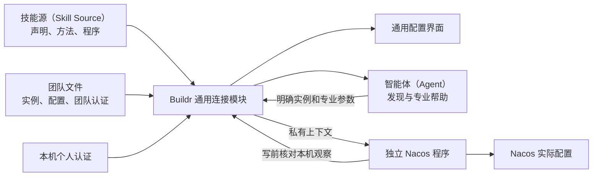

## Context

本设计是组合任务（Composite Task）extensible-connections 的首阶段方案，所属子任务为 connection-skills-nacos。动机及范围见 [proposal.md](proposal.md)。用户已确认方案并授权第一阶段实现；代码和本机验证位于任务隔离工作树，正式交付激活与真实外部系统验证分别处理。

### 已观察实现

| 当前事实 | 源码依据（相对产品根） | 本阶段处理 |
| --- | --- | --- |
| 四种系统由源码注册，注册键为 type | services/buildr/src/modules/connections/application/connection-provider.ts；connections-application.ts | 旧路径保留，新路径按技能资产与声明身份选择 |
| 专业操作直接出现在通用类型中 | services/buildr/src/modules/connections/domain/connection.ts | 新通用模块不增加 nacos/mysql 等业务成员 |
| 连接保存于本机 SQLite，密码另行加密 | services/buildr/src/modules/connections/persistence/connection-repository.ts | 旧路径不动；新实例采用团队文件与本机覆盖 |
| 四套表单显式分支 | services/buildr-web/src/features/connections/components/ConnectionEditDrawer.tsx | 新页面按同一声明渲染 |
| 技能源已支持 assets、scripts、references 及完整投射 | services/buildr/src/modules/agent-assets/application/skills.ts；infrastructure/runtime/skills/projection-files.ts | 复用身份、登记、来源与附件，不另建技能安装器 |
| 外部已解析来源目前主要读取单个 SKILL.md | services/buildr/src/modules/agent-assets/infrastructure/runtime/skills/sources.ts | 首版采用随包及本地完整目录；不承诺远端完整程序包安装 |
| 组件禁止可执行模块扩展 | services/buildr/src/modules/agent-assets/domain/component-definition.ts | 保留边界，程序由连接执行边界以子进程启动 |
| Nacos 授权与发布保护分散在应用、基础设施及本机记录中 | services/buildr/src/modules/connections/application/nacos-configuration-application.ts；persistence/nacos-publish-authorizations.ts | 独立接入必须带走完整专业职责，不能只复制请求客户端 |

现有规范中的 SQLite、本机密码与规范工作空间（Canonical Workspace）目标语义适用于旧连接路径。新机制改变了来源与共享方式，必须通过本变更明确双路径范围，不能用文档暗中覆盖旧承诺。

## Goals / Non-Goals

**Goals:**

- 用一个真实已有系统贯通声明、登记、页面、文件共享、个人覆盖、命令发现、执行及结果验证。
- Buildr 发布时无需知道未来接入系统及业务命令；新增专业命令只更新接入成果。
- 随包 Nacos 与用户自制接入经过同一解析、绑定和执行路径。
- 同一当前实例可由页面、命令行接口（CLI）、编辑器和 Git 改变；各入口发现变化并防止覆盖旧观察。
- 制作指引能够让另一智能体（Agent）按规范完成一个未预先硬编码的接入样例。

**Non-Goals:**

- 不建设统一业务操作清单、业务编排器、生产许可平台或完整外部控制台。
- 不加载接入成果提供的任意网页代码，不设计通用前端插件系统。
- 本阶段不迁移或删除旧实例，不重接 MySQL 查询，不制作云雀私有实现。
- 不要求扩展市场、签名服务或新的团队秘密管理系统作为首版前置。
- 不制作界面原型（UI Prototype）；实现验证使用隔离构建、模拟和真实页面。真实登录及读取仅在用户授权的测试目标执行，不执行真实部署或配置发布。

## Decisions

### 1. 连接是普通技能的标准用途

连接技能（Connection Skill）是包含接入声明及必要程序的普通技能（Skill），继续使用现有源资产、启用及投射方式。新增的是连接用途约定，不是第二种技能生命周期。

类别（Category）只帮助浏览和搜索。configuration 表示配置系统，不意味着成员都必须支持发布。systemId 表达系统名称；稳定接入身份为技能 assetIdentity 与声明 definitionId 的组合。sourceIdentity 用于核对来源，不能用名称、类别或安装顺序代替绑定。

每个实例首版只选择一份接入声明。这份声明可以引用多个自带程序或已安装程序。安装另一份同系统方法只增加选项；改绑是单独、显式、带版本检查的动作，必须展示配置兼容差异和新的认证接收方。

选择这一方式是因为现有能力绑定（Capability Binding）按作用域选择协作方法，不能直接表达同类别多个实例各用不同实现。只有专业方法之间确实存在稳定协作保证时，才另用已有能力契约（Capability Contract）。

### 2. 交付目录与声明归属

拟交付两个公共技能源：

    resources/workspace/skills/connections/nacos-connection/
      SKILL.md
      assets/connection.yml
      references/commands-and-results.md
      scripts/nacos-client.mjs
      scripts/lib/...

    resources/workspace/skills/buildr/connection-authoring/
      SKILL.md
      templates/...
      references/connection-contract.md

这些目录属于产品资源源文件；通过既有资源映射成为用户工作空间（Workspace）的普通技能源。随包 Nacos 与用户自制连接统一登记在 `skills/connections/<skill-id>/`，其中包含 `SKILL.md`、接入声明及必要程序、参考资料；不要求用户接入进入 Buildr 公共仓库。制作指引属于普通技能（Skill），继续位于 `skills/buildr/connection-authoring/`。配套程序不从产品旧 connections 模块导入，也不依赖开发检出路径。

完整本地源经 `skills add` 登记时使用标准目录；本地目录登记要求连接成果已位于该位置。清单中不符合标准的连接来源仅作局部诊断，不加载或擅自搬移。本功能尚未发布，不为前一版试验目录建立兼容、迁移或保留旧目标分支；普通技能（Skill）行为及真正的旧连接模块保持原状。目录规范不建立第二套清单、安装器或运行时（Runtime）。

技能清单条目增加可选 connectionDefinitions 数组，内容为技能目录内的相对声明路径。默认示例为 assets/connection.yml。解析结果显式透传引用，复用文件边界和来源校验；路径越界、符号链接逃逸、重复声明身份均局部报错。

读取声明不执行程序。Buildr 直接从受管技能源解析，智能体（Agent）阅读其实际投射入口；二者共享稳定身份及来源观察。投射尚未发生时，页面仍能解释已登记声明，不能声称当前智能体（Agent）已经加载；执行时不得用陈旧投射中的同名程序替代当前来源。

### 3. 最小声明格式与 Nacos 样例

以下格式已由新连接模块实现，正式交付激活另行处理。schemaVersion 表达协议格式；configVersion 表达配置语义兼容版本；普通说明修改不要求提升 configVersion。

    schemaVersion: buildr.connection-definition/v1
    definitionId: nacos
    name: Nacos
    description: 配置发现、读取、比较和受控发布
    category: configuration
    systemId: nacos
    configVersion: 1
    config:
      fields:
        - { key: consoleUrl, label: 网站地址, type: url, required: true }
        - { key: namespaceId, label: 命名空间编号, type: select, default: public, optionsFrom: namespaces }
        - { key: defaultGroup, label: 默认分组, type: string, default: DEFAULT_GROUP }
        - { key: apiVersion, label: 接口版本, type: enum, values: [auto, v1, v2, v3], default: auto }
        - { key: production, label: 生产环境, type: boolean, default: true }
    authentication:
      fields:
        - { key: username, label: 用户名, type: string, required: true }
        - { key: password, label: 密码, type: secret, required: true }
      targetFields: [consoleUrl]
    programs:
      cli:
        kind: bundled
        runtime: node
        entry: scripts/nacos-client.mjs
        contextProtocol: buildr.connection-context/v1
    hooks:
      test: { program: cli, args: [test, --json], effect: read }
      namespaces: { program: cli, args: [namespaces, --json], effect: read, inputs: [config.consoleUrl, authentication.username, authentication.password] }
    presentation:
      categoryLabel: 配置系统
      methodLabel: Buildr 标准接入
      summaryFields: [consoleUrl, namespaceId, defaultGroup]
      websiteField: consoleUrl
      groups:
        - { id: connection, title: 连接信息, fields: [config.consoleUrl, authentication.username, authentication.password, config.production] }
        - { id: scope, title: 使用范围, fields: [config.namespaceId] }
        - { id: advanced, title: 高级设置, fields: [config.defaultGroup, config.apiVersion], collapsed: true }

production 是 Nacos 专业字段及既有授权语义，不是通用类别要求，其他系统不被强制添加。默认 true 沿用现有保护；用户明确选择测试目标时可保存 false，不从环境名称推断。网站字段需要通用 HTTP/HTTPS 规范化并拒绝嵌入账号密码；Nacos 路径及接口解释归其程序。认证目标基于声明选定的规范化配置字段、接入来源及所选账号形成绑定，不把默认分组当作另一认证目标。

首版支持文本、网址、整数、布尔、固定枚举、单选和多选；提供长度、数值范围、必填、默认值、分组和简单依赖条件。秘密字段没有密码默认值。配置字段不能通过普通字段类型绕过认证组。复杂数据判断归程序，声明不包含任意脚本表达式或动态网页代码。

标准执行槽位只包括有界测试、动态选项和必要的本机可用性检查。业务命令不进入通用动作枚举。测试与发现程序不得以发布、部署或其他业务写入实现测试。

`presentation.groups` 仅声明有序区块、已有配置或认证字段引用及默认折叠；每字段至多引用一次，不执行代码，未列字段有兼容回落。视觉上混合配置与团队认证不改变存储和整组认证语义。`categoryLabel` 和 `methodLabel` 仅为纯文本展示，不参与绑定。发现槽位可用 `inputs` 声明地址、账号等有限前置字段；只放松未列配置字段的必填校验，所有已提供配置仍作类型校验，所选认证始终完整且核对目标。完整测试、保存和专业执行继续全量校验。

### 4. 团队文件与个人认证

团队实例使用 connections/instances/<connection-id>.yml，一实例一文件，不复用旧 connections/manifest.yml。这样能够减少不相关实例同时编辑的冲突，也不会被旧一次性导入逻辑误读。

    schemaVersion: buildr.connection-instance/v1
    id: connection-<稳定编号>
    name: 测试配置中心
    environment: 测试
    enabled: true
    category: configuration
    binding:
      skillAssetIdentity: <技能资产身份>
      definitionId: nacos
      sourceIdentity: <已选择来源>
      configVersion: 1
    config:
      consoleUrl: https://nacos.example.com/nacos/
      namespaceId: public
      defaultGroup: DEFAULT_GROUP
      apiVersion: auto
      production: false
    authentication:
      targetBinding: <认证目标绑定>
      values:
        username: <团队账号>
        password: <团队密码>

示例中的值均为占位。类别是便于缺失声明时展示的登记值，保存及执行时必须与绑定声明一致，不能用它选择替代实现。用户已选择团队参数及团队认证通过团队 Git 文件共享；本方案不附加外部秘密系统前置。实际团队实例文件属于用户工作空间（Workspace），不进入公共 Nacos 技能源、示例、任务材料或发布包。

个人认证单独沿用本机加密存储技术，由用户本机数据位置保存；不放入共享目录。先按规范工作空间身份与实例身份判断记录是否存在，再校验记录内的目标绑定。目标绑定不作为查找键：目标变化后必须仍能发现那份失效的个人记录，不能因查不到新目标的键而回退团队认证。秘密组整体加密并有独立本机版本，不在任务记录或 SQLite 复制第二份共享实例事实。

专业执行及已保存实例测试的选择规则（草稿只读测试的显式候选选择见第 8 节）：

    有个人认证记录 → 使用完整个人组
    没有个人认证记录 → 使用完整团队组
    所选组缺失、失效或无法解密 → 报告该组不可用
    显式移除个人组 → 后续改用团队组

用户名与密码不跨来源拼接。个人组错误、过期、目标不匹配时保持个人来源，不尝试团队账号。团队密码更新也不会替换个人来源。普通读取只显示认证来源、可公开用户名、是否配置及诊断，不返回秘密值或可用于猜测密码的独立摘要。

目标绑定防止 Git 只改站点后将旧密码送往新站点。通过应用修改目标时必须明确重新提供或确认绑定认证；直接文件编辑形成不一致时只拒绝相关认证动作，不自动更新绑定。个人组绑定也独立核对。

### 5. 单机文件来源与观察版本

团队源文件、声明、本机认证分别维护观察版本（Observed Revision）。编辑读取携带 teamRevision、definitionRevision、localRevision；保存团队文件只核对团队及声明，保存个人认证核对目标、声明及个人版本。含秘密的文件与认证版本对外使用本机密钥派生的不透明观察令牌，不暴露可离线试猜密码的普通内容摘要；令牌只供同一本机应用核对，不要求在团队成员间保持相同值。首次实际读取含秘密的实例时，按需建立仅本机可读的稳定观察密钥，使从团队 Git 取得配置后的多个命令行进程可以接续；该初始化不修改团队文件、不复制认证、不迁移旧存储。无实例的目录读取不创建密钥。

采用逐文件锁、写前重读、临时文件及原子替换保护应用入口；发现外部编辑或 Git 冲突标记时拒绝覆盖并保留草稿。普通编辑器不遵守应用锁，必须披露最后核对与替换之间的局限，不宣称跨 Git 和任意编辑器的全局事务（Transaction）。不自动逐字段合并秘密组。

普通列表只读取文件，不迁移或修复存储，不因局部损坏隐藏其他合法实例。目录解析后按实例身份查重，重复身份明确诊断，不按文件顺序取首项。不得用损坏文件触发旧 SQLite 回退。

新机制按单机版（Standalone）处理：所选工作空间（Workspace）目录是唯一实例配置入口，读取其当前文件即可。团队通常将配置保存在主工作分支（Branch），Buildr 不锁定分支名称、不切换分支，也不为代码工作树（Worktree）另建配置来源。智能体（Agent）从相关代码目录操作时仍使用已选工作空间的配置。

用户主动切换该工作空间仓库的分支（Branch）后，以磁盘当前文件为准：文件不存在就显示未配置；由用户恢复文件或切回包含配置的分支，不查历史、不复制旧配置、不自动恢复。文件仍存在但改变时，沿用普通文件观察版本与认证目标检查即可。这里保留的版本校验只保护并发编辑和目标正确性，不建设多分支配置管理。

### 6. 通用入口、命令发现与程序安装

新命令空间暂定 buildr connection-skill；旧 buildr connection 保持。新命令只组织以下通用动作：

| 通用动作 | 用途 |
| --- | --- |
| definitions list / inspect | 找到声明、所属技能、来源、实际方法入口及程序要求 |
| list / get / create / update / remove | 管理所选工作空间目录的实例与观察版本 |
| auth set / use-team | 保存个人整组认证或显式移除个人覆盖 |
| check / help | 观察程序可用性、取得所选程序自身帮助；帮助不交付认证 |
| test / discover | 调用声明中的有限页面槽位 |
| run | 将专业参数数组交给明确绑定的程序 |

命令名称是拟议接口，实施时沿现有命令路由统一确认；它们不能扩展为 nacos publish、mysql query 等系统内置分支。团队秘密输入通过完整配置文件或标准输入（stdin）提交，个人认证通过受限输入提交，不作为命令参数。

例如：

    buildr connection-skill get <id> --json
    buildr connection-skill help --connection <id> --program cli
    buildr connection-skill run --connection <id> --expected-revision <revision> --program cli -- list --page 1

最后的 list 及其参数由 Nacos 程序定义；Buildr 不解析业务意义。多个同类别接入可并列出现；已有实例提供准确方法入口，新增时明确选择来源。

首版支持随技能附带程序，以及声明指向的已安装程序。后者直接声明可执行名称、版本探测和安装说明，或复用已有命令声明（Command Declaration），不强制先将公司专业命令登记到 Buildr 公共目录。

程序解析得到实际可执行位置及身份，使用参数数组启动，不拼接外壳命令（Shell Command）。随附程序受技能目录边界保护；外部程序解析后的路径、来源与版本发生改变时重新观察并明示受影响实例，不能同名接管。普通文档更新不等于认证接收方改变，同来源常规升级沿用已成立授权；来源替换或改变实际接收方不能静默进行。

目录加载不安装依赖、不联网测试、不执行版本探测。源已登记、已投射、程序存在、依赖版本满足、程序可启动、外部测试成功分别报告。缺依赖只阻止依赖该程序的动作，合法配置仍可保存。

### 7. 配置与认证交接

Buildr 通用启动器只保护本机身份、来源、版本、目标及秘密交接。Nacos 配套程序负责远端对象、专业授权和副作用。子进程（Subprocess）隔离不被宣传为安全沙箱（Sandbox）。

私有上下文只通过当前启动的独立进程通道交给所选程序，不能作为普通调用结果打印。协议包含以下信息：

    protocolVersion: buildr.connection-context/v1
    callId: <单次调用身份>
    workspace: { id, root }
    definition: { skillAssetIdentity, definitionId, revision }
    connections:
      primary:
        id: <实例身份>
        revision: <实例观察>
        config: <已核对配置>
        authentication: { source, values }
        authenticationRevision: <不暴露秘密的本机观察标识>
    privateStateRoot: <本机、按提供者隔离的临时及专业状态目录>

上下文与业务标准输入（stdin）分离，保留现有 --content-file - 等用法。首个 Nacos 程序使用产品 Node.js 基线，通过独立双向管道收取上下文；其他技术可以使用满足同一逻辑约定的薄适配程序。禁止把真实上下文写入参数、普通环境变量或公开临时文件。

通道仅允许初始化上下文、重新核对本次上下文及必要的受限诊断。程序在真正外部写入前请求 revalidate，宿主重读本次绑定的实例、声明、接收方与认证版本；变化时返回冲突，不能静默替换新认证继续操作。宿主不解释发布命令，也不审批业务行为。

Nacos 跨实例比较使用显式命名的第二上下文，例如 compare；启动器逐项核对被明确指定的实例，不提供全量密码枚举。帮助和离线检查没有认证上下文。

通用启动器限制超时与输出体积并处理终止；超时和进程结束不能推断远端没有生效。程序退出成功也不自动等同业务完成。专业结果由程序表达，Nacos 保留 published、verified、unchanged、serviceReloaded 等独立事实。

输出保护包含声明秘密字段及已知认证值的跨输出块处理；Nacos 程序另负责登录令牌、远端认证回显和业务结果结构。原始配置作为专业产物写入受限本机新文件，不能在遮蔽后冒充原文或继续用于摘要与发布。不承诺识别任意业务秘密，也不承诺阻止有本机权限的用户主动读取团队文件。

### 8. 新界面与声明式槽位

首版新增 /connection-skills 页面，作为“连接（新机制）”入口，与既有连接页清楚区分。只展示新实例，避免同名旧实例被误认作已经迁移。页面沿用 Buildr 现有列表和编辑抽屉（Drawer）布局，直接实现正式页面，不生成原型（UI Prototype）。

| 区域 | Buildr 固定行为 | 由接入声明提供 |
| --- | --- | --- |
| 列表 | 名称、来源、绑定、当前认证来源、局部可用性、编辑入口 | 类别、系统名称、少量非秘密摘要 |
| 新增 | 按类别展示具体系统；确有多实现时明确选择方式 | 系统名称、类别展示名、接入方式说明及配置字段 |
| 团队配置 | 保存团队文件，校验当前观察 | 参数及团队认证字段、简单校验 |
| 我的认证 | 默认收起；已有或异常时显示摘要；独立保存／移除个人组 | 完整认证组字段 |
| 测试 | 执行中、成功／失败／未知、验证时间与范围 | 测试程序和已验证项目 |
| 动态选项 | 有界读取、选择真实编号、过期响应丢弃 | 发现程序、字段依赖与标签 |
| 原网站 | 校验地址、新标签页打开、不附认证 | 网站字段或受限静态路径规则 |

新增先按类别选择具体系统，再进入该系统表单；同系统仅有一份方法时直接明确绑定该项，有多个方法时展示可区分的接入方式及来源供选择。编辑直接显示系统与实例，不展示不可变的技能身份选择器。主界面不铺开内部身份、源路径及程序诊断，它们在接入详情中按需查看；异常需有可发现入口。

名称、环境在基本信息中展示；配置与认证按声明区块排序。Nacos 先填地址及团队账号，再读取并选择命名空间（Namespace）；默认分组和接口版本收进高级设置，生产标识保持明显，不根据环境文本推导。已有团队认证先显示账号已配置摘要，通过“更换账号”进入整组替换，移除属于次要操作；不以空字符串混同保持或清除。

团队配置及团队认证、个人认证位于同一编辑页的两个区域；底部主“保存”只写团队区域，展开个人区后的“保存个人认证”只写本机，避免一个按钮横跨两份存储后只能笼统报失败。个人区域始终默认折叠，已有个人组或失效时仍有简短状态；折叠不改变有效来源。初次未配置个人组时选择团队来源；已有个人组时反映实际个人来源。修改账号需重新提交配套秘密，声明允许空密码时保持其实际语义。

“使用个人认证”开关只改变当前草稿，点击“保存个人认证”后才新增／替换个人组，或在关闭状态下显式移除个人组并恢复团队来源。取消或离开未保存草稿不改变实际认证。保存团队区不会顺带保存个人区草稿，反之亦然。页面区分“当前生效账号”与“本次测试账号”，测试前说明配置范围及认证来源。

主保存成功且没有未保存的个人修改时关闭编辑抽屉并刷新列表；失败或冲突保留抽屉和输入。存在个人草稿时，团队保存后保留页面并在固定底栏提示个人修改尚未保存。仅展开个人区域、未修改或恢复原值不算草稿变化；个人保存及冲突后重新读取均不关闭编辑器。

测试页面明确采用当前草稿还是已保存实例，并显示实际认证来源。底部“测试连接”只验证主表单团队候选，个人折叠区自带个人候选测试；低频开关不隐式改变主测试对象。专业执行与已保存实例测试继续按已保存个人组优先的规则选择。任何草稿测试均不保存、删除或切换持久认证，候选缺字段或认证失败时报告该候选问题，不改用另一来源重试。

更改依赖字段或认证后，旧测试结果失效；迟到响应不恢复旧结果。保存只要求字段合法，不以测试通过为前提。测试失败后仍能保存，页面显示“已保存，未验证”，并保留最近失败的诊断及时间，不把失败改写为成功。未经测试的保存同样显示未验证；当前草稿测试不能冒充其他版本或已保存来源的成功证据。缺少测试声明显示“未提供测试”，不能伪装为失败。

动态选项返回 value、label、观察范围、分页／截断、warnings；当前页未出现已选编号时保留并说明未在本次结果中。Nacos 首版只提供命名空间（Namespace）发现，分组（Group）保持手填。

测试结果包含 status、checks、observedAt、diagnostics、limitations，并关联草稿及上下文观察。页面默认仅显示结果和认证来源摘要，时间、细项与限制按需展开；动态发现反馈贴近选择字段。仅登录成功不能宣称配置发布可用；不执行发布来测试连接。

MySQL 专用查询工作区是独立专业界面，不塞进表单语言。本阶段保留旧入口，设计要求未来仅在接入满足其具体输入输出约定后才能绑定该工作区，不因 data-source 类别自动获得查询能力。

### 9. 独立 Nacos 提供者

Nacos 使用 configuration 类别，提供自己的完整命令行接口（CLI）：帮助、测试、命名空间发现、配置列表、读取、比较及发布。Buildr 只知道程序入口和通用槽位。

调用路径为“智能体（Agent）→ Nacos 随附程序 → Nacos 接口（API）”。接口封装代码归随附程序，SKILL.md 说明其用法与判断方法；Buildr 只启动所选程序并交接配置认证。首阶段完整适配既有能力，保全现有确定性保护，不要求真实生产发布作为验收。该具体技术选择不强制未来所有连接采用相同执行技术。

独立程序需要移植的责任不止网络请求：

| 现有责任来源 | 独立程序必须保全的行为 |
| --- | --- |
| domain/nacos-connection.ts、nacos-types.ts | 对象身份、参数、内容与格式语义 |
| infrastructure/nacos-http.ts | 登录、令牌、同目标请求、重定向拒绝、有界响应和读取重试边界 |
| infrastructure/nacos-provider.ts | 接口版本适配、目标核验、完整元数据、远端并发保护与回读 |
| application/nacos-configuration-application.ts | 完整差异、跨实例比较、连接版本再核对、生产授权、相同内容免写入、结果分层 |
| persistence/nacos-publish-authorizations.ts | 每次生产尝试的本机授权使用事实 |
| interfaces/cli/nacos-cli.ts | 专业帮助、参数约束与原文文件输入输出 |

上述均归 Nacos 接入成果自身。本阶段可复用已验证算法形成独立程序副本，但不从旧模块运行时导入，不要求旧模块改为依赖新程序。由此产生的短期重复以双路径回归和后续迁移控制，不能为消除重复提前改动旧行为。

发布继续只针对已存在配置，核对 namespaceId、group、dataId、完整内容摘要及格式，保留管理元数据。已确认版本优先使用原生比较并交换（CAS）；旧、未知或定制版本使用写前重读并明确竞争窗口，不因缺原生能力单独阻止普通发布。

生产逐次授权和一次尝试使用记录属于 Nacos 程序，放入其 privateStateRoot，不进入团队文件，也不升级成通用连接许可机制。提供者负责真实用户授权依据的正确使用，程序检查不冒称能够识别人类。

相同内容不发布；未知写入响应不重发；发布受理、回读验证和服务加载分别表达。失败后已发生事实保留。原文的字节顺序标记（BOM）、换行、空白和完整摘要继续保持。

### 10. 官方接入开发技能与验证闭环

connection-authoring 是普通可选技能（Skill），不新增通用能力契约或状态库。它指导智能体（Agent）：

1. 核对真实系统、可用接口与工具、认证、对象身份、支持范围和未知项。
2. 在 `skills/connections/<skill-id>/` 生成完整 SKILL.md、接入声明、必要程序、依赖说明及参考文档，不嵌入真实实例值。
3. 通过离线声明检查及自带模拟场景检查身份、字段、认证、依赖、未知结果和输出边界。
4. 沿现有技能登记与投射入口启用，明确实例绑定；安装不改绑已有实例。
5. 在实际授权范围内分别检查程序可执行、连接可用及业务动作；不为证明制作完成擅自触发真实写入。
6. 用简短摘要报告完成程度，详细用法按需读取，适配用户从基础到深入的认知过程。

基础说明足以支撑边界明确的简单读取；Nacos 的对象定位、发布并发、生产授权和失败恢复必须放入专业方法。通用作者技能提供可验证结构，不替作者编造系统能力。

按服务（Service）询问配置时，由 Nacos 专业技能（Skill）指导读取准确代码库和启动条件，确定配置中心地址、命名空间（Namespace）、分组（Group）及配置编号（dataId），再匹配已有连接并查询；不新增长期服务绑定模块。共享、扩展及后续导入依据实际加载机制有界追踪。环境名称不等同于配置档案（Profile），仓库同名文件不证明远端内容或回退行为；运行覆盖未知时单独说明，不把远端可读当作服务已加载。制作指引以用户代表性场景检查对象定位、连接选择、专业执行和结果核验，并由另一智能体（Agent）独立试用，区分真实、模拟和未验证范围，不要求所有系统具备相同功能。

必须增加一个测试专用的未知系统接入样例：不修改 Buildr 的系统分支或业务命令表，就能注册声明、呈现表单、发现自带命令并取得正确上下文。这是验证抽象成立的证据，不作为新的正式产品提供者发布。

用户另行明确将基本沟通规则纳入本任务。在产品源 services/buildr/resources/workspace/AGENTS.md 的“用户沟通”中补充下面的原则，沿既有受管分发机制更新，不手工改写根目录的受管区块（Managed Block）：

> 面向用户的引导、解释和回复遵循少即是多，从简到繁、从基础到深入：先给简明结论和当前需要理解或决定的内容，再按需要逐步展开。详细依据可放入独立材料；保持判断、授权、失败、未知和验收所需信息完整，并尊重用户明确要求的详细程度。

这是一条沟通约束，不规定固定字数，不强制每次分多轮回复，也不要求把智能体（Agent）应自行完成的过程变成逐项人工确认。连接制作指引只引用这个原则，不复制另一套规则。核对普通问答、较大方案概览和明确要求详细设计三类场景；复用 core-user-facing-language、core-rule-skill-authority 及 inline-workspace-core-rules 的相应检查，不为文字规则新增逐字匹配的测试或全局门禁。产品规则源已修改并验证隔离初始化分发；正式自举激活由收尾执行器（Runner）负责，实际结果单独核对。

### 11. 模块归属与调用关系

实现结构：

    services/buildr/src/modules/connection-skills/
      domain/           声明、实例、认证来源与结果约定
      application/      目录读取、保存、上下文解析、启动与槽位用例
      persistence/      团队文件与本机认证读取写入
      infrastructure/   程序解析、进程通道、输入输出边界
      interfaces/       通用 CLI 与 HTTP
      module.ts         具名装配
    services/buildr-web/src/features/connection-skills/
      pages/            新连接目录
      components/       通用字段、团队配置、个人认证与结果
      api/              新模块客户端

目录表达职责，不要求每个动作拆成文件。agent-assets 暴露当前技能及连接声明引用的公开读取能力，新模块不直接修改技能清单或反向接管投射。团队文件与本机认证由新连接模块各自唯一写入，前端与命令行接口（CLI）共用这些应用用例。

调用关系：页面／智能体（Agent）→ 通用连接应用 → 声明与实例快照 → 所选程序 → 外部系统。专业程序可要求宿主重验本次上下文，但不反向取得任意实例或任意路径访问接口。

图中的专业执行只发生在独立程序，Buildr 维护通用事实与交接边界。

数据权威：技能源保存定义；团队文件保存实例及团队认证；本机认证保存个人组；外部 Nacos 保存配置内容和发布事实。目录缓存、测试观察和任务记录均不替代这些事实。

## Risks / Trade-offs

- 团队认证随 Git 复制与保留 → 按用户已确定的团队共享方式实现；页面明确团队／本机保存，普通输出遮蔽，公共包和示例不含真实值，不再要求额外秘密系统。
- 配套程序可接收密码 → 明确来源与接收方，使用独立进程和私有通道；不声称声明或文件摘要证明程序无恶意。
- 文件由 Git、编辑器和应用共同修改 → 当前观察校验、冲突保留及逐实例文件；不自动覆盖或声称跨入口原子性。
- 新旧两份 Nacos 逻辑短期重复 → 独立回归保全既有保护；新路径闭环后再决定迁移和删除。
- 程序成功退出但外部效果未知 → 通用层仅报告进程与协议事实，专业程序报告业务证据；写入不自动重试。
- 不同操作系统的独立管道支持存在差异 → 在实现早期验证目标平台，保留标准输入（stdin）；未验证平台明确限制，不能降级把秘密放进参数。
- 普通读取可能产生过量或敏感输出 → 结构化有界结果、已知认证遮蔽、原文受限产物分离；不以遮蔽后的正文作为发布输入。

## Migration Plan

1. 先在隔离位置交付通用声明解析、文件及认证模型、启动协议和新页面，旧路径不参与初始化。
2. 以独立 Nacos 源目录走完整登记、投射、配置及执行链；制作指引使用同一声明校验入口。
3. 完成离线、模拟、页面与安装包消费检查，再在明确授权的真实目标验证。真实读取、受控发布及业务效果分别记录。
4. 新机制不可用时，停用其入口仍保留全部新文件及个人认证；用户可继续使用已有旧实例。不得通过自动复制密码、自动删文件或悄悄回退旧实例伪装恢复。
5. 后续子任务逐个处理 MySQL、Kibana、XXL-JOB 和旧 Nacos 实例迁移。每个实例显式确认来源、目标、配置差异及团队／个人认证归属；当前私人认证不会自动转成团队文件。
6. 仅在功能、调用方、数据和依赖均保全并得到相应交付授权后退役旧模块。集鲜云雀在其私有工作空间（Workspace）独立制作。

## 验证与阶段完成

| 验证层 | 必须证明 | 不能据此声称 |
| --- | --- | --- |
| 规划校验 | 提案、设计、规范和任务相互一致，旧新边界明确 | 程序已实现或已接入 |
| 离线与模拟 | 未知提供者可加载；团队／个人选择；版本冲突；私有通道；Nacos 专业保护 | 真实账号、网关和版本兼容 |
| 页面 | 字段无系统分支，分别保存、草稿过期、缺依赖及来源可见 | 远端发布或业务生效 |
| 安装消费 | 正式包、完整技能源和独立程序可用，无开发源码依赖 | 所有操作系统已验证 |
| 真实只读 | 当前授权目标的登录、范围、读取和结果完整性 | 发布成功或生产权限充足 |
| 真实受控写入 | 另获授权的测试配置发布、回读和未知结果接续；真实生产发布不属于验收要求 | 服务加载或业务验证完成 |

当前已完成主要实现及本机验证，子任务保持进行中。模拟、命令行、页面、安装包消费和独立作者接入均按实际结果记录。用户进一步授权复用已有测试连接后，独立 Nacos 程序已通过真实只读登录、命名空间发现、一页配置读取、完整原文取得及同内容比较，观察到接口（API）v1；同一已有账号分别经团队组和本机个人覆盖组通过上述读取与比较，不代表另一真实账号的权限已验证。验证使用隔离临时实例，原连接未修改，认证及原文未进入公开材料，临时现场已清理。没有执行真实配置发布或重启；其他真实接口版本、定制网关及 Windows/Linux 实机仍未覆盖。

用户预览反馈后的重排已完成：连接系统目录、有序混合字段、默认折叠个人账号及高级设置、分来源测试与固定底部保存，以及 `skills/connections/<skill-id>/` 标准登记。未发布试验布局不做兼容或迁移。新的声明、发现、目录、包消费、制作指引和前端宽窄流程均已通过实际检查，并重建重启隔离预览；该次界面重排未继续访问真实外部系统。其后已另获授权，独立智能体（Agent）通过当前配置完成只读查询，并按新增服务定位方法从代码识别三份准确配置，在隔离安装更新技能（Skill）后完整读取并核对；这些事实不证明运行服务已加载或真实发布通过。

正式页面沿用既有形态，未制作界面原型（UI Prototype）。实现后的任务验证报告、任务收尾、资源清理和任务终态由各自能力按真实授权处理，不放入 OpenSpec 实施勾选清单；子任务设计或实现完成都不自动完成组合父任务。

## Open Questions

- 真实只读目标已按用户指令从已有测试连接取得并完成验证；若继续真实写入验收，仍需明确专用测试配置及写入、恢复范围，不从只读授权推导。
- 独立管道在各支持操作系统上的具体句柄行为与异常退出回收，由最早的执行边界验证确定；协议始终保持秘密通道与业务输入分离，不以未测行为作兼容承诺。
- 真实部署中的定制版本、反向代理和原生比较并交换（CAS）支持程度，逐次观察并归入 Nacos 专业兼容说明。
