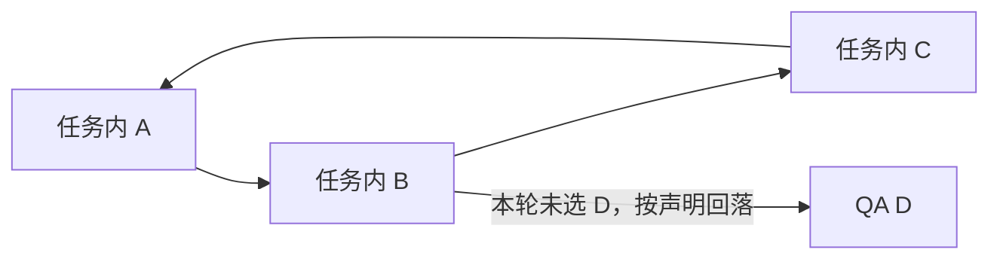

## Context

动机见 [proposal.md](proposal.md)。本设计基于已经集成的 `8577b5ee6624b5624d374d6dc3c2f53ecb33d88d`：`local.backends`、`backendTargets`、`connections`、旧单对象读取和切换前重验均已存在；任务组合仍递归等待下游就绪，不能直接承担双向发现关系。

### 已完成的最小验证

真实锚点为集鲜 `services/freshx-pigs/runtime.yml` 及其实际构建包。构建包依赖包含 Spring Boot 2.7.3、Spring Cloud 3.1.3、Nacos Client 1.4.2 和既有 `GrayRoundRobinLoadBalancer`；构建包 SHA-256 为 `b223075932d2773b71c57f2213af55a2c787b59122e16aa8e10f060cb7511eed`。没有改写该运行定义或 `verifiedAt`。

2026-10-23 完成 14 项真实检查：峰值五个独立 JVM，任务 A 的 A/B/C、任务 B 的 B 和同名 QA 服务诱饵；使用实际打包的灰度选择器、Spring Cloud Feign/RestTemplate 调用组件和 Nacos 客户端。新增的实验性候选提供器只查询任务专用分组（Group）及既有 QA 范围。

| 观察 | 结论 |
| --- | --- |
| Feign、RestTemplate 分别完成 A→B→C→A | 服务调用关系成环可行，其他任务 B 未收到这些调用 |
| 本任务没有 UPMS，另一个任务存在同名诱饵 | 两种客户端均连接真实 QA UPMS，健康结果 `UP` |
| 本任务和 QA 均没有目标 | 明确失败，不使用其他任务同名目标 |
| 未声明目标、选定目标消失、同任务同端口出现新运行 | 拒绝调用；接收方按旧运行编号检查时返回 409，未进入业务处理 |
| 重新观察并显式选择新运行编号 | 调用恢复，仍留在本任务 |
| 原生 `HintBasedServiceInstanceListSupplier` 的不匹配对照 | 返回全部候选，包含其他任务；不能直接作为严格 QA 回落规则 |
| 注册受理与实际发现 | 存在可见性间隔；首次探针将“受理”误当“可发现”而失败，修正观察条件后通过，原始失败记录保留 |
| 清理 | 所有探针进程退出；无活跃注册；两个唯一任务分组（Group）的服务清单均复核为 0；QA UPMS 候选集合前后相同 |

删除空服务条目曾返回 `No corresponding Raft Group found : naming_service_metadata`；后续只读列表确认两个任务范围均为空，没有修复或变更共享 Nacos。不能将第一次删除报错单独推断为残留或删除成功。

验证材料在正式任务 `local-service-lanes` 的本机记录中接续；实验源文件 SHA-256 为 `70a8073e0bb13b01e195055a35bc22a369f28f85218f4afc911d6eea141cae32`。这是实际组件、独立进程和共享发现环境的验证；没有启动完整 freshx-pigs/UPMS 业务应用，没有验证 Spring Boot 自动装配（Auto-configuration）、网关、固定 URL 或消息消费隔离。实验中手动装配组件的成功不得记成这些边界已通过。

### 后续真实应用接入结果

2026-10-23 已在集鲜隔离工作树完成完整业务应用验证。使用各仓实际 Maven 构建产物；UPMS 在同一构建反应堆（Reactor）中包含新公共组件，freshx-pigs 的完整应用包仅替换本次构建的 `saas-common-gray` 与 `saas-common-job` 两个依赖，没有发布依赖或部署 QA。峰值四个完整进程，每个 UPMS 实际装配 1003 个对象，每个 freshx-pigs 实际装配 2143 个对象，使用自动装配的 `RetryableFeignBlockingLoadBalancerClient`。

28 项检查均通过：双任务各自双向 Feign/负载均衡 RestTemplate 调用、未选本地 UPMS 时回落真实 QA UPMS、其他任务未收到调用、旧目标消失明确失败、同端口新运行不接替、接收方拒绝旧编号、明确重新选择后恢复、未声明目标拒绝。QA 注册集合前后相同。进程均退出；初次注销回读出现旧实例，随后按精确身份清理并确认本次所有实例为空。空服务条目删除仍可能遇到前述 Nacos 元数据错误，不扩大共享系统修复范围。

真实接入核实了默认 Nacos 客户端会排除 `weight=0`，本地已选编号路径因此读取完整任务实例再严格过滤，QA 保持原有权重规则；现有 Sentinel 扩展要求诊断接口保留 `@FeignClient`，诊断调用需要正常请求上下文；两端健康状态分别采用字符串及包含 `code` 的对象，只有明确 `UP` 才通过。6 项纯单元测试补充摘要、任意地址拒绝、零权重、任务身份、替换和 QA 错误边界。

验证期间停用 UPMS 共享缓存初始化、消息消费、延迟任务执行与作业注册，由完整应用中的实际对象及容器状态确认；不注入认证或密钥。上述结果证明完整应用接入与只读健康联通，不代表业务数据隔离、完整业务流程、网关、固定地址或消息路径验收。后续由 Buildr 受管入口再核对同一协议。

### Buildr 实施及受管入口验证

已实现版本 2 定义、逐目标身份选择、任务内泳道分配、派生文件与摘要、循环发现组合、切换前重验、共享只读观察及现有界面消费。直接地址旧声明和运行记录保持兼容；文件不含认证、密钥或任意目标 URL。

集鲜提供可接续的本地准备及启动脚本：临时聚合构建（Maven Reactor）显式选择 gray、job、UPMS 和 freshx 四个模块，使两个完整应用直接包含本次公共组件，不再替换包内依赖，不发布依赖或将候选组件安装到共享本机仓库。启动前核对源码及产物摘要，转发实际端口，并保持已核实的共享副作用关闭参数。

先用新脚本完成两个完整应用及双向 Feign/RestTemplate 直接验证，再进入生产运行应用和 HTTP 适配。受管验证完成 28 项检查，涵盖双任务双向调用、专业观察匹配、候选不含其他任务、选定目标消失、同端口新运行拒绝、接收方旧编号 409、预检失败保留调用方、明确选择恢复及真实 QA 回落。该现场使用独立测试任务/目录适配；规范任务登记和真实 Git 归属由实际模块集成测试另行证明，不能将测试适配称为规范任务登记。

受管实验原始报告调用检查全部通过，但即时进程退出回读偏早导致命令退出码 1。独立后续观察确认所有自有进程与注册实例为空，共享 QA 候选集合前后相同；原始报告不改写。验证程序已补退出回收等待，避免将通知时差记成活跃残留。两个服务的版本 2 候选定义在这些真实结果成立后才保存，`verifiedAt` 使用实际验证时间。

相关检查覆盖 11 项新泳道集成、原有定义/连接/持久化/生命周期/任务组合/模块/HTTP/CLI 回归、30 项前端逻辑检查、完整类型检查与网页构建。扩大执行的低成本完整回归另有既有失败：Markdown 测试不能解析无扩展名的 `copyText`、安装模块反向层引用、两个正式规范的占位 Purpose；这些文件与本次修改无关，保留原失败并独立说明，不把完整回归写成全绿。没有执行完整业务流程、网关、固定 URL 或消息路径验收。

## Goals / Non-Goals

**Goals:**

- 同任务、同本机的本地运行相互发现；没有选择本地目标的已声明下游按固定上下文回落 QA。
- 由真实组件执行专业选址，Buildr 维护任务身份、受管运行、已观察版本和可重建的注入文件。
- 保留旧声明及运行读取，对未知、失效与部分成功作准确表达。

**Non-Goals:**

- 共享 QA 透传任务身份或重新调用本地；跨主机任务互调、回连通道、每任务注册中心、全量本地环境。
- 数据库、消息队列、定时任务及业务数据隔离；自动改造所有调用路径。
- Buildr 内置 Spring/Nacos 实现、发布集鲜依赖包、修改共享配置或部署正式服务。
- 首版动态热更新（Hot Reload）正在运行的调用方；连接变更沿用明确的重启入口。探针热读文件仅用于验证显式刷新后的行为。

## Decisions

### 1. 首例使用任务专用发现范围，QA 保持既有范围

集鲜本地组件将不透明泳道标识（Lane ID）映射到任务专用 Nacos 分组（Group），只把本次本地运行注册到该范围；QA 回落只查询已核实的既有 QA 范围。注册发现与配置中心的分组（Group）分别处理，不把本地运行身份扩散到共享配置读取。

现有普通 QA 调用方继续查询既有范围，任务之间也不会互为候选。实际组件必须核实这一点后才启用；`weight=0` 不承担隔离保证。选用同范围元数据（Metadata）筛选也能实现，但会要求所有相关 QA 消费者正确排除开发目标；本次采用已经验证的专用范围，避免先改变共享调用方的候选集合。

### 2. 扩展现有目标列表，以版本 2 使新语义显式

仍在 `services/<code>/runtime.yml` 的 `local.backends` 保存全部已声明下游，不新增另一份依赖清单。版本 1 的三字段条目内部归一为直接地址类型；版本 2 使用带类型的条目，支持直接地址及服务发现（Service Discovery）。发现条目包含 `serviceCode`、`serviceId` 及 `fallback: {kind: existing-discovery, context: qa}`；`context` 是已验证既有配置的名称，不授权选择任意注册中心。

发现条目不要求 `remoteUrl` 或逐项 URL 注入变量。参与泳道的服务另外声明 `local.routing`，指定自身真实发现名称 `serviceId`、整个运行上下文文件的注入变量及只读观察路径。自身名称必须沿代码核实，不能从服务编码猜测。以下是拟实施的声明结构，业务侧同名变量和路径已在完整应用中验证，仍需由 Buildr 实现读取与生成：

```yaml
local:
  routing:
    serviceId: service-a-app
    environmentVariable: LOCAL_SERVICE_ROUTING_FILE
    format: buildr.local-service-routing/v1
    observationPath: /actuator/local-service-routing
  backends:
    - kind: service-discovery
      serviceCode: service-b
      serviceId: service-b-app
      fallback:
        kind: existing-discovery
        context: qa
```

`serviceCode` 不重复；直接地址注入变量不重复，且不得与运行上下文变量冲突；同一调用方的发现名称不重复。没有真实代码支持这些入口时只保留候选材料，不写为已验证运行定义。旧 `local.backend`、版本 1 `local.backends`、旧 `connection` 和现有 `connections` 持续可读；读取不改文件、不刷新验证时间。版本 2 避免旧 Buildr 静默忽略新字段。

### 3. 本地组件消费通用上下文，技术栈负责选址

Buildr 生成 `buildr.local-service-routing/v1` JSON，包含 `format`、`laneId`、`workspaceId`、`taskId`、`hostId`、`runId`、`serviceCode`、自身 `serviceId`、`targets` 与 `digest`。每个目标包含服务编码、发现名称及 `mode: local|qa`；仅本地目标包含 `runId`。摘要为除 `digest` 外所有字段递归按键排序、紧凑 UTF-8 JSON 的 SHA-256，前缀 `sha256-`。内容只来自声明和当前受管运行，不接收请求传入的 URL、环境变量集合或文件路径，也不包含认证、密钥与业务数据。

文件是运行记录的派生投射，保存到本机运行目录并由声明变量传入路径；校验摘要后启动。首例采用环境变量（Environment Variable）传文件路径：当前 freshx-pigs 包装命令只显式转发 `$1`，不能假定追加多个启动参数会进入 Spring。集鲜组件负责在注册前加载调用方身份、注册到任务范围、提供候选筛选及接收方运行身份检查；Buildr 不读取 Nacos 认证，也不把私有代码或地址打入产品资源。

泳道标识（Lane ID）由当前工作空间（Workspace）、任务和本机的受管运行共同确定。在现有运行锁内复用同任务活跃记录中的唯一身份，无活跃参与者时创建新身份；歧义只阻止该范围的后续写入。身份保存在运行记录中，不新增第二套任务生命周期。生成文件使用服务自己的运行编号及内容摘要，未知旧字段保持未知。

### 4. 未选目标可以回落，已选目标失效必须显式失败

| 选择与观察 | 结果 |
| --- | --- |
| 已选择本地运行 | 仅匹配同任务、同本机的受管 `runId`，发现结果还须与其一致 |
| 没有选择本地下游，声明允许 QA | 使用声明的既有 QA 上下文，并保存回落原因 |
| 已选运行缺失、未就绪、被替换或发现结果存在歧义 | 返回该连接错误，不能切换到 QA、其他任务或新运行 |
| 注册中心不可达、声明缺失或覆盖点未验证 | 显示具体缺口，不能把错误视为“没有本地目标”后放行 |
| QA 也没有可用目标 | 连接不可用，保留已成功启动的其他进程 |

直接地址条目的旧默认值与跨范围显式选择不变。发现条目的默认自动选择使用上述任务策略；`local` 保持严格本地，`remote` 使用已声明 QA 上下文，`backendTargets` 的显式 `run` 只能指向本任务。不能把旧直接地址自动模式的不唯一即回落原样用于任务发现。

### 5. 切换检查与实际接收共同保护运行身份

复用 `backendTargets` 中的运行观察，并补上上下文摘要。停止原调用方前重新核对声明、任务、代码来源、进程身份和各目标；校验失败保持原运行。校验后目标再故障，新调用明确失败；停止后启动失败仍准确保存停止事实，不承诺无条件恢复旧进程。

调用方本地组件携带已选择的目标运行编号；接收方本地组件在业务处理前验证编号，防止旧地址被后来进程复用。该编号不是认证凭证。发现缓存或注册受理不能替代接收方身份检查；新运行必须经重新观察和明确切换才可接替。不能提供该检查的调用路径不得宣称具备运行期间的防接替能力。

### 6. 发现关系的环不变成启动等待的环

任务组合先为明确选择的参与者分配运行编号并形成目标快照，再启动各进程。发现关系的目标按名称和运行身份解析，不要求在启动调用方前已有目标端口；需要实际 URL 的旧条目仍等待其对应目标就绪。只对地址前置关系检查无法满足的循环，不再拒绝所有服务调用环。

本地目标尚在启动时，相应调用返回未就绪，不回落 QA。业务应用若在初始化期间必须同步调用尚未启动的伙伴，需要在实际接入时明确处理；探针成功不证明完整业务应用已经支持该启动方式。每项启动结果独立，局部失败不停止无关成功项。



图中每个本地调用方独立执行同一选择规则；QA D 后续继续使用 QA。

### 7. 选择快照与当前运行观察分别展示

已有 `connections` 增加发现目标类型，保存发现名称、本地运行编号或 QA 上下文及选择原因；QA 地址尚未解析时不伪造 URL。兼容 `connection` 字段只投射真实直接地址信息，没有对应信息则为空。

本地组件按声明的只读路径返回自己的 `runId`、上下文摘要、发现状态及逐项实际目标/错误；Buildr 仅访问当前受管本地地址与声明路径，先校验返回身份。没有观察结果时展示未知；“进程就绪”“注册受理”“目标可发现”和“业务场景已验证”分别说明。不会因文件生成或注册日志存在就展示连接成功。

在现有服务详情、任务运行、启动/切换入口及日志说明中补充这些事实，不新建部署管理入口。首版发现目标只展示同任务候选；旧直接地址条目的显式跨范围选项保持原有语义。

### 8. 实现职责与智能体入口

```text
services/buildr/src/modules/service-runtime/
  domain/runtime-definition.ts                 版本与目标类型、已声明注入入口
  domain/runs.ts                               泳道身份、上下文及连接快照
  application/service-runtime-application.ts    解析、重验、启动及切换
  application/service-task-runtime-application.ts 组合身份分配与有界等待
  application/service-runtime-view.ts           合成当前事实与局部诊断
  infrastructure/local-routing-context.ts      新增：派生文件与有界只读观察
  persistence/runs-repository.ts               新旧记录兼容读取
  interfaces/cli/ 与 interfaces/http/           共享输入和结果
services/buildr-web/src/features/service-runtime/ 既有界面与客户端
```

智能体（Agent）从原有本地运行方法进入：读取真实声明、代码、客户端与启动包装，确认专业组件版本及覆盖范围，在候选上启动并执行只读请求，再保存真实验证时间。未覆盖的固定 URL、普通 RestTemplate 或网关路径必须列明，不按框架名推定支持。新增文件只承担运行投射和观察这一稳定职责，不建设通用插件平台。

## Risks / Trade-offs

- 注册、缓存及发现存在时差 → 等待身份匹配的当前观察；未就绪不回落，保留实际失败，不用固定睡眠制造成功。
- 标签筛选不匹配返回全部目标 → 发现范围限定为本任务及固定 QA，保留其他任务诱饵反例；不使用原生提示的宽松回落。
- 完整应用已验证，受管入口尚待实现 → 复用已核实组件协议，通过 Buildr 启动再核对注入与观察，才保存相应已验证定义；不把健康联通扩张为业务场景验收。
- 本地组件与产品上下文协议不一致 → 版本、摘要和运行编号校验失败时只拒绝相关连接；不自动降为未受管调用。
- 外部注册清理可能返回错误 → 仅处理精确任务归属资源，回读实际进程、实例及空服务清单，区分成功、残留与未知；不借此修复共享注册中心。

## Migration Plan

1. 先在业务侧隔离目录完成实际应用自动装配、注册范围、观察与接收方身份检查；仅做本地只读验证，不自动发布依赖包或部署 QA。
2. Buildr 同时读取版本 1/2 与新旧运行记录，完成受管启动和现有界面消费；所有旧直接地址回归保持。
3. 智能体（Agent）在实际应用验证后选择性保存版本 2，不批量迁移、不补造验证时间。首次启用先检查 QA 既有范围不会发现本地目标。
4. 退出候选时停止精确任务运行并恢复原声明；运行事实按实际状态保留，不自动回滚或覆盖他人文件。当前授权按此顺序实施，不批量迁移无关服务。
