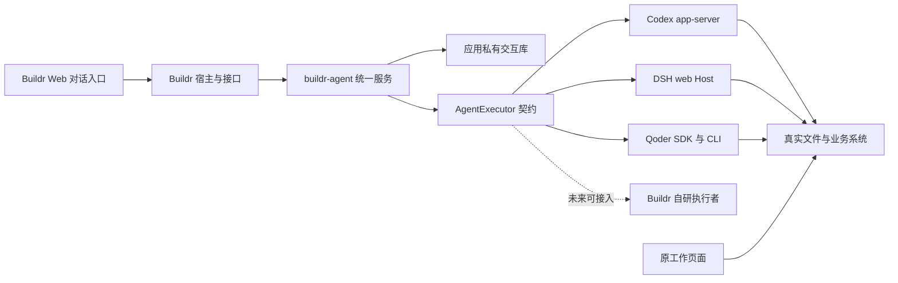
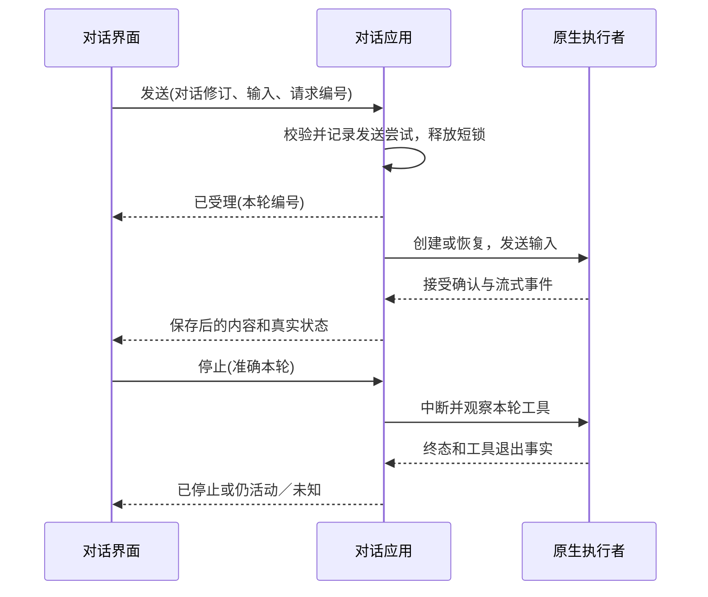

## Context

动机和范围见 [proposal.md](proposal.md)。本设计基于已审原型、三家隔离真实实验，以及当前正式代码的有界核对。它是拟议实现，不是当前功能说明。

现有后端使用 `src/modules/*/`，由 `src/bootstrap/runtime.ts` 和 `module-registry.ts` 装配；旧 `agent-operations` 承担一次生成，`native-session-links` 承担外部会话关联。前端由 `src/app/` 维护应用壳（App Shell），领域功能在 `src/features/`。这些位置来自当前正式源码，不能照实验脚本直接复制为产品。

本轮观察的原生组合是 Codex `0.163.0-alpha.11.1`、DSH `0.2.1-rc.2`、Qoder 软件开发工具包（SDK）`1.0.55`＋`qodercli` `1.1.75`。Codex 公开稳定版 `0.163.0`只核对过协议，没有重复真实模型验证；正式支持列表必须在实施时用可独立安装的程序重新通过同组验收。实验使用桌面随附可执行文件不意味着产品依赖桌面运行。

现有超文本传输接口（HTTP）的模块响应端口没有服务端事件流（SSE），默认 JSON 请求体上限为 32 KiB，写请求校验同时包含本机令牌、来源和 JSON 类型。新增流及图片不能套用后绕开认证或全局放宽限制。

## Goals / Non-Goals

**Goals:**

- 使接入、可见对话、原生执行和真实工作对象各有唯一责任，普通聊天不依赖任务流程。
- 在独立源码服务（Service）中完成首版闭环；公共服务与具体执行者（Executor）分离，发送与控制操作分离，错误局部化，已有入口与数据保持。
- 让已确认原型中的状态都有可观察后端事实，保留将来接入具体业务现场的输入与事件边界。

**Non-Goals:**

- 公共服务不建立推理循环、通用工具调度、自动团队、全局工作对象库或通用许可层；本版不实现 Buildr 自研执行者。
- 独立服务纳入项目组成，但第一版不另设公开发布包、单独安装程序、后台守护进程或网络端口；不承诺后端退出期间工作持续执行。
- 不改变旧桌面接入、任务生命周期、工作空间资产存储或提交说明路径；不导入旧聊天与凭据。

## Decisions

### 1. 独立服务、宿主与执行者分别维护

```text
services/buildr-agent/
  package.json                    私有本地包与单一公开导出
  src/
    index.ts                      创建服务、公开契约与类型
    application/                  账号、对话、接续、观察与控制用例
    domain/                       参与身份、状态准入与交付规则
    persistence/                  私有交互库、迁移与事务
    executors/                    执行者契约及实际接入装配
      codex/                      Codex 原生适配
      dsh/                        DSH 原生适配
      qoder/                      Qoder 原生适配
  test/                           服务自身的单元与集成验证
  tools/                          本服务构建和验证入口
services/buildr/src/modules/agent-service/
  module.ts                       库装配、公开能力注册及生命周期桥接
  interfaces/http/                宿主鉴权、请求映射与事件流传输
services/buildr-web/src/features/agent-conversations/
                                  账号、历史、输入、消息及工具交互
```

这是拟议源码布局，不要求每个动作都拆文件或创建空层。主要对象为连接应用（ConnectionApplication）、对话应用（ConversationApplication）、执行协调器（ExecutionCoordinator）、私有仓储（ConversationRepository）及执行者契约（AgentExecutor）。三家的原生适配器（NativeAgentAdapter）是该契约的当前实现。服务公开方法围绕 `connect/login/inspectAccount`、`create/read/prepareSend/send`、`observe/stop/reply` 组织；数据访问只由本服务仓储承担。

Buildr 宿主负责解析应用配置域（Profile）、验证请求来源、解析已登记工作空间和核对任务，再通过明确的查询端口与配置输入装配服务。`buildr-agent` 不反向导入 `buildr/src`，宿主不深入导入 `buildr-agent/src` 内部文件。服务导出安全的语义事件与订阅，超文本传输接口（HTTP）及服务端事件流（SSE）序列化留在宿主。旧一次生成队列、旧接入登记及旧外部关系库均不是新服务依赖。

公共服务维护统一对话和控制准入；具体执行者（Executor）负责实际工作及其上下文。公共契约提供能力说明、建立／恢复上下文、提交输入、读取历史／状态、响应原生交互、取消与释放。恢复引用由执行者拥有且对公共层不透明，但必须可核对来源与身份；命令行进程、程序路径、厂家配置格式、登录方式和原生消息形状属于各家实现，不是所有执行者的强制前提。

第一版通过显式装配表注册 `codex`、`dsh`、`qoder`。公共对话、持久身份与基本界面消费经过校验的执行者描述和能力，不在核心状态机中按三家写分支；厂家名称、特殊配置和必要差异留在各家边界。未注册、未验收或不可用的执行者不能因传入一个字符串就被调用。暂不建设动态插件发现、第三方代码装载或版本市场。

`buildr-agent` 服务与未来“Buildr 自研智能体（Agent）”是两种身份。未来自研执行者可在同一契约下与外部执行者并列，自己持有推理和工作上下文，不需要伪装成命令行工具（CLI）。本版不创建其实现或运行身份，不显示不可用的占位选项；仅用不依赖命令行的测试替身验证公共契约可工作。未来是否建设、采用什么推理引擎、如何登录和运行仍另行设计。



服务源码、进程和发行分别决定：`buildr-agent` 独立维护源码、依赖及测试，首版由 Buildr 同进程装配并随主包交付，厂家执行进程仍独立。未来确需后端退出后持续工作或其他宿主消费时，再评估拆运行宿主；独立源码服务不以独立部署为前提。

新服务按私有本地包组织，公开包入口建议为 `@buildr-ai/buildr-agent`。开发准备先物化此包，再由 `buildr` 通过同一公开包入口消费；正式主包采用显式捆绑依赖（Bundled Dependency）收录该私有包及必要运行依赖和迁移资源，不要求将其单独发布到公共包仓库。开发与打包不得分别走相邻源码导入和已安装包两套行为。动态载入的厂家客户端、运行资源及原生程序选择必须逐项检查，不能以构建通过代替安装消费验证。

实施时使用项目组成能力登记 `buildr-agent`，源码位置为 `projects/product/services/buildr-agent`，引用现有已核对代码库实例，保留原三个服务。准备声明与测试地图需在真实入口形成后纳入该服务及主包组合验证；当前只有已确认规划，不创建空目录或假定准备／验证入口已存在。

### 2. 按应用配置域保存私有交互数据

```text
resolveWebProfile().dataRoot/agent-service/
  conversations.sqlite            buildr-agent 私有交互记录
  connections/<connectionId>/
    codex-home/                    CODEX_HOME
    dsh-home/                      DSH_HOME，含原生历史
    dsh-agents-home/               DSH_AGENTS_HOME，资产来源独立
    qoder-config/                  QODER_CONFIG_DIR
  attachments/<attachmentId>      有界图片，内部编号定位
```

程序只建立对应厂家的子目录。沿用正式版、开发版和预览环境已有的配置域解析；预览必须使用独占数据根，不能写保留安装的账号或交互库。根目录仅本机用户可访问，不进入工作空间、Git、长期资产或跨机器同步。

选择一个服务私有数据库（Database）而非把对话分散进各工作空间数据库，是为了让一套账号服务多个工作空间，保持新单元生命周期独立。实际私有数据根由宿主解析后注入；服务不得自行猜测正式／开发路径。已有设计中的 `dataRoot/agent-service/` 与接口路径保持，代码服务名称不要求迁移本机数据。数据库仍按 `workspaceId`隔离查询；“全局入口”不意味着把不同工作空间材料自动混合。任务、偏好与组织资产继续使用原来的 `.buildr/local/workspace.sqlite`，不迁移、不双写。

只读查询在库不存在时返回空或未初始化，不写迁移；首次显式写入由本服务事务初始化，维护单独的版本与迁移记录。未知较新版本、损坏或权限错误只限制新能力，不让旧任务页面不可读。写入提交后才发布可见事件，崩溃恢复不凭页面状态猜事实。恢复与迁移测试包含正式／开发／预览根的负向隔离。

### 3. 身份与事实分开保存

| 记录 | 关键内容与责任 |
| --- | --- |
| `AgentConnection` | `id/provider/bindingIdentity/revision/enabled`；`provider` 必须对应已注册执行者，`bindingIdentity` 由该执行者解释并核验。首版三家绑定中另存 `executableIdentity/version/configIdentity`，账号秘密不入表；每个配置域每家仅一个启用槽。 |
| `LoginAttempt` | `attemptId/connectionId/generation/state`；官方登录中的地址只通过受认证响应交给前端，诊断不记录临时令牌。进程重启后未完成尝试重新核对或标失败。 |
| `Conversation` | `id/workspaceId/cwd/taskId?/title/revision/visibility`；目录在首次发送后固定。文件移动或工作空间缺失时显示原身份与诊断，不静默迁移。 |
| `Participant` | `id/conversationId/connectionId/bindingIdentity/contextRef/deliveredThrough`；`contextRef` 是执行者拥有、可核验的恢复引用，首版三家内部映射准确配置来源和 `nativeSessionId`。不根据标题或最近访问猜测，也不要求未来自研执行者生成外部线程编号。 |
| `Entry` | 对话内递增序号、实际发送者／参与者、可见正文或工具摘要、原生条目身份与执行身份、图片引用；不保存隐藏推理或全量原生日志。 |
| `Run` 与 `DeliveryAttempt` | 本轮编号、原生本轮编号、服务代次、客户端请求编号、输入摘要、实际交付范围、接受确认、模型终态和活动工具；持久化不确定结果。 |
| `PendingRequest` | 产生请求的参与者、本轮、原生请求编号、代次、类型及有效状态；授权和问题通过这一身份回复。 |

连接可用性、模型是否运行和工具是否退出是不同事实。界面状态由这些事实投影：空闲、执行中、等待问题、等待授权、正在停止、已停止、仍有工具、状态未知、接入失败。一个对话在执行、待回应、停止或未知期间只能保留草稿；其他对话可独立工作。数据库只短暂保护准入和登记，不在模型执行期间持锁。

`Entry` 依照 `(participantId, nativeEntryId, itemKind)` 等经适配验证的稳定身份补齐；没有稳定编号的厂家需保存可重读的位置映射。不能按正文哈希合并两条内容相同但合法的消息。流式部分回复原位更新同一条目，终态与重读仍对应同一来源。

### 4. 三家适配与账号流程

| 厂家 | 首版装配 | 必须保留的差异 |
| --- | --- | --- |
| Codex | 独立 `codex app-server --listen stdio://`；每个配置一服务，可承载多对话 | 公开官方登录；不调用标为内部专用的认证路线。新线程编号可能尚未物化；中断后核对并按准确原生终端身份终止残留命令。 |
| DSH | 独立 `dsh web --no-open --port 0`，官方客户端（Client）和生成的远程模块 | `DSH_HOME` 与 `DSH_AGENTS_HOME` 分开；登录从初始化转为等待浏览器，完成前保持准确宿主；模型选择影响该独立接入后续默认模型。 |
| Qoder | 固定官方软件开发工具包（SDK）及其匹配 `qodercli`；每段活动会话一个进程 | 官方 `qodercli login` 在准确配置建立账号；显式启用已验证的 `.agents/skills` 发现；问题回复按实际协议，工具许可不冒充操作系统隔离。 |

适配器提供初始化能力声明、账号／模型观察、创建、恢复、历史读取、发送、原生回复、中断、工具观察及释放。可选项分别标为支持、不支持或未验证；没有验收的图片、运行中追加、模型与扩展不显示成可用。程序缺失或版本不兼容返回具体安装／版本指引，不自动下载升级，不依赖外部桌面存活。

登录流程为未登录→初始化→等待官方页面→账号检查→可用，分支包含取消、超时、过期和失败。前端“已完成登录”仅触发观察，不自行认定成功；资料和模型目录分别核对。一个连接一个当前尝试，旧尝试回执不能覆盖新尝试；关闭面板不退出账号。

配置按白名单构造子进程环境，移除不属于此接入的桌面通信令牌、默认认证来源与实验目录；保留正常网络代理等必要运行环境。凭据由厂家配置或官方安全存储维护。诊断仅输出脱敏账号、版本、能力及本服务错误，不转储认证缓存或原生日志。

起始目录（CWD）默认取明确工作空间根，可在首次发送前选择真实存在的目录；目录归属与访问权限分别说明。原生进程读取工作空间规则、技能及目标路径适用规则；不每轮复制整套知识。跨目录由原生权限及用户授权决定，不自动复制其他用户级扩展。

### 5. 创建、发送与恢复

1. 全局新建先展示输入草稿；有明确工作空间和起始目录后才保存 Buildr 对话（Conversation），不创建缺少归属的持久记录。未选范围时草稿仅留在该浏览器标签页，用户选择准确工作空间与目录后通过对应工作空间接口创建，再允许发送。从任务创建时先核对稳定任务身份；只有一个可选任务引用。
2. 发送前核对连接与配置身份、目录、当前本轮和输入能力。创建或恢复准确参与绑定，保存发送尝试；短事务结束后异步调用原生服务。
3. `clientRequestId` 只保证本服务重复请求返回同一接受事实；不承诺原生跨进程严格恰好一次。若原生接受确认不明，保存未知，不自动创建另一线程或重发。
4. 用户消息从发送中转为已接受或明确失败／未知；不能先显示成功再丢失。确认原生接受后推进参与者交付位置，收到内容后更新可见记录。
5. 刷新、重连和后端重启先读本服务历史，再逐参与者核对准确原生历史和状态，补齐去重。不能把无历史读取权限、编号丢失或配置失配当成空会话。

Codex 首条消息前的未物化仅限“本次新建且已证明从未发送”可视为零历史。已绑定对象恢复失败必须保留原记录并诊断。创建原生对象后保存绑定失败，保留创建尝试与已知编号后修复；不知道编号且无法按该尝试安全关联时，不用“最新线程”猜测。仅能证明未发送时才可重新创建空对象；已可能发送则保持未知并先核对。



### 6. 手动换家与有界接续

选择下一位执行方只是草稿选择，不创建原生对象或参与记录。发送前 `prepareSend` 返回与对话修订、目标参与者、实际来源序号和输入摘要绑定的预览。界面可查看工作空间、任务、目录、实际可见正文／工具摘要和本次新指令。

首次参与交付必要的可见记录；换回先恢复该参与者的准确原生会话（Session），再补 `deliveredThrough` 之后未交付的记录。自己的原生回复由历史映射核对已见位置；水位只证明收到相应内容，不表示目标完成。历史工具和授权作为只读参考，不重放为控制消息；新执行者重新检查现场。

预览内容以安全文本封装，明确历史来源与本次要求；引用中的指令不能获得新的授权。凭据、隐藏推理及无关工作空间内容排除。适配器为固定版本给出可验收的输入容量；同时设置字节上限。超过任一限制保持全部历史与草稿，显示原因，允许继续原执行方，或由用户明确编写／确认精简说明。说明保存为带用户来源的可见条目，并进入未来参与者的增量；不得默默截断、自动摘要或声称完整迁移原生上下文。

发送时再次校验预览修订和摘要；期间有新消息或当前执行变化返回冲突并刷新预览，不静默发送旧内容。原配置失效只限制对应参与者；确认无活动执行后可以手动选其他可用厂家，不能自动代选或把新会话伪装为旧上下文恢复。

### 7. 停止、断开与退出

停止请求指向 `conversationId/participantId/runId/nativeTurnId/generation`。先提交原生中断，然后分别观察模型和属于本轮的工具、终端；正常确认自动更新。没有证明退出时保留工具仍活动或未知，不能用定时器、请求返回成功、流关闭或进程号消失之外的猜测替代事实。

Codex 原生 `commandExecution.processId` 不是操作系统进程编号；仅按适配器映射调用准确终端终止。不得按名称扫杀全机进程，不得用重启一套共享宿主终止某一对话而影响其他对话。

面板关闭、切页面只改变显示，事件继续由后端保存。断开接入禁止新发送，按本服务归属对活动本轮请求有界取消并核对后释放连接；未确认的记录仍为未知，账号和历史保留。后端退出使用既有生命周期完成同类有界退出并记录观察结果，不等待无限长模型轮次。重新启动只恢复观察，未完成工作需用户明确继续。崩溃后不按旧操作系统进程编号直接发送信号，先核验准确进程身份或原生运行事实。

### 8. 独立命令接口与事件流

以下是新接口（API）设计，不复用 `/api/v1/app/agents`，正式契约仍按现有版本化请求／响应机制登记。

| 作用域与动作 | 输入／输出与边界 |
| --- | --- |
| `/api/v1/app/agent-service/connections` | 列表、选择兼容程序、账号／模型检查、连接与断开；写操作携带连接修订。 |
| `.../connections/:id/login-attempts` | 创建、观察、取消准确登录尝试；仅返回此尝试的官方地址，不输出凭据。 |
| `/api/v1/workspaces/:wid/agent-conversations` | 有界列表、创建；可按准确 `taskId` 过滤，不能跨工作空间返回内容。 |
| `.../:cid`、`.../:cid/entries` | 读取、重命名、隐藏、游标分页及实际本轮状态；新对话最初没有原生会话。 |
| `.../:cid/prepare-send`、`.../:cid/send` | 接续预览与提交；请求编号、修订、目标参与者和实际输入摘要，受理即返回，不持请求等整轮。 |
| `.../:cid/stop`、`.../:cid/requests/:rid/reply` | 准确本轮的停止、授权和回答；过期代次／请求返回冲突并引导重读，不能改投其他厂家。 |
| `.../:cid/observe`、`.../:cid/events` | 显式核对原生状态；以游标订阅安全事件。失去缓存游标时给重读指引，不自动发送业务指令。 |
| `/api/v1/app/agent-service/pending-requests` | 只返回有权访问的对话身份、工作空间及必要状态，不复制全部正文；跨页面可发现待回应。 |
| `.../:cid/attachments` | 受认证、单独有界的图片上传／读取，返回内部引用；发送时验证归属和真实模型能力。 |
| `.../:cid/generate-title` | 用户显式为已完成的可见问答请求精短摘要，携带已观察修订；允许旧对话按准确选择更新，不猜测旧名称是否手动保存，不迁移整库。 |

含账号、对话、图片或事件的读取也需本机令牌与同源约束。对来源头（Origin）缺省的合法同源读取，使用明确同源请求信息与令牌核验；不能直接套要求 JSON 的写校验到 GET。共享接口层拆出不依赖媒体类型的本机认证，原写请求继续保留 JSON 和来源检查；不扩展跨域或云端认证。

浏览器以带 `x-buildr-session` 的 `fetch` 读取服务端事件流（SSE），不在 URL 放认证令牌。`buildr-agent` 提供语义事件和有界订阅，Buildr 的宿主桥接通过共享 `respond.stream` 输出已认证流；服务核心不接收原始请求／响应对象。断连仅解除订阅，不停止工作；有界缓存、心跳及慢消费者断开避免内存无限增长。重连用事件游标，失效后重读持久历史。事件含对话、参与者、本轮、服务代次、原生来源和类型，迟到旧代次事件不应用于当前请求。

首个订阅在同一同步执行段中读取持久快照并登记增量缓冲，发送当前本轮、待回应及最近一页记录，随后发送该水位之后的事件；其间不跨异步等待，避免读取与订阅之间漏事件。历史使用独立游标分页，最近页同时按条数和4 MiB正文预算限制，单个合法较大条目允许独立一页。每次重连均提供新持久快照，不依赖短期事件重放；游标与服务代次只标识观察位置，不触发重新执行。每个订阅缓存不超过 1,000 条或 8 MiB；心跳 15 秒。慢消费者或过大初始快照关闭该订阅，客户端保留已有材料，通过分页和显式观察重新读取，不中断原执行。传输层未消费输出不超过8 MiB，正常合法帧可等待最长10秒排空，不能只因超过底层高水位就立即断开。

正常停止的首次连续观察预算为 10 秒，超出后依据真实已知事实显示仍有工具或未知，后台有效观察可继续推进；时间到本身不是停止证据。新服务退出资源处理总预算 10 秒，先登记未完成事实，再取消和核对自有资源，截止时保留诊断并交还既有退出入口。以上均是首版工程默认值，通过超时／慢消费者测试验证边界，可在不改变状态语义的前提下校准，不以固定时长替代实际结果。

首版文本提交的原有 JSON 限制保持；新消息路由按明确契约允许最多 64 KiB 文本（请求信封上限 128 KiB），超限在副作用前返回明确错误。图片使用独立二进制路径，首版最多 4 张、每张 8 MiB，验证实际类型与文件签名；不接受 SVG 或任意文件解析。附件与对话、发送尝试关联，未提交临时图片保留24小时，后续上传时回收过期引用，每对话最多暂存32张或64 MiB；已发送引用保留。目标执行者不支持图片时阻止该次发送并允许移除图片或换可用执行者，不默默忽略。

实际限额由能力响应提供给前端，适配器可返回更小限制。工具长输出按稳定来源保留可见摘要及截断标记，完整事实由原生历史或真实文件读取；不向前端泄露原生凭据和隐藏推理。渲染安全 Markdown 与已支持文件引用，第一版不执行模型返回的 HTML 或任意交互代码。

### 9. 前端状态与已确认布局

`src/app/` 只维护全局打开、当前对话选择、停靠和宽度；`features/agent-conversations/` 维护专用客户端、消息和账号交互。功能挂在工作页面路由之外，避免切页面卸载活动对话。原 `WorkspacePaneHost`、`WorkspaceStage` 仍负责中右双屏的挂载、折叠、暂看与编辑现场；新增对话不改变其对象身份。

一级图标顺序为工作台、工作空间、代码；真实 `AppNavigation` 二级内容复用，悬停不挤压工作屏，固定展开后才占宽。二级导航收起时，一级图标悬停只切换临时导航，鼠标点击不跳页或固定；浮层内的展开按钮固定当前组。固定展开后停止悬停预览，点击其他一级图标直接切换固定菜单组，重复点击当前组保持展开，仍由原按钮收起；键盘与触屏遵循同样的固定态切组。当前预览或固定组使用既有选中底色，不使用点线标记，完全独立于浏览路由与已打开工作页签。对话默认最右，左移时整体排到一级图标列之前，历史在同一对话面板中替换显示。窄屏保持原有覆盖阅读方式，不强压四栏或产生页面横向溢出。

悬停二级导航保留工作区完整上下高度，菜单行与分组内部收紧；固定后的宽度沿用已有菜单偏好。对话与原屏使用相同分隔组件（SplitDivider），补齐标题栏分隔标记。桌面全局对话入口收拢到侧边图标和面板控制，不保留重复顶栏按钮；窄屏仍有顶栏入口，三者共用开合状态；桌面收起后保留对话图标，悬停可操作同一面板，点击才固定展开，展开后的收起按钮位于右端。浮窗与固定态保留草稿和当前记录，自己的下拉及授权交互不误收起。手机使用全局入口。顶部常驻历史、短标题、新建、更多；账号设置归入对话内部。停靠宽度为320–800px，与内容可用宽度一致，正文和输入栏不附加更小居中上限；专注模式保留阅读宽度。输入栏左侧为附件和权限；右侧依次放独立的智能体（Agent）、模型、思考档位和发送控件。选择执行方后使用其默认模型并清除原模型及档位，选择模型后清除不适用档位；选择控件只更新草稿，不创建或执行对话。选择器使用一致的28px行高、清晰正文色、白色背景及相同悬停状态，不因菜单展开或层级切换改变输入栏高度；禁用与完全访问保留有意义的差异。按完整控件自然换行，完整显示正常名称及档位，不加“思考”前缀。创建回执不覆盖较新显隐意图，浮窗发送也不自动固定。

模型目录同时返回实际默认模型、逐模型思考深度（Reasoning Effort）及默认档位；发送预览、本轮执行和恢复记录保留所选值。切换执行方或模型时重置不兼容的显式档位，发送前再次核对能力；适配器每轮明确传入有效档位或原生默认，避免上一次原生设置污染新轮。未声明该能力的模型不呈现虚构的思考选项。

#### 9.1 显式权限模式

输入栏左侧与附件并列提供“默认权限／完全访问”，不再增加顶部常驻操作；执行位置仍在输入框下方。新对话始终从默认开始；同一对话的明确选择在换家时保留，未创建草稿只向其准确新建对话转移，不能从共享新建偏好继承上一段对话的完全访问。运行期间的选择仅用于下一轮，不改变正在执行的权限，不回应既有授权；尚未发送的选择与实际本轮模式分别呈现。刷新可从保存选择及准确本轮读回，不以界面显示代替原生生效。

`permissionMode` 仅取 `default | full-access`，输入缺失按 `default`；发送预览明确返回解析值，并纳入预览签名、重复请求身份及持久本轮记录。旧执行缺少字段仍按默认读取。能力 `permissionModes` 缺失只表示支持默认；不支持或不能确认应用时，在工作输入发送前局部拒绝，保留草稿和选择，不静默降级。该字段是用户对本轮原生执行的显式选择，不是自动批准所有请求的通用许可层。

| 执行方 | 默认权限 | 完全访问 | 逐轮应用边界 |
| --- | --- | --- | --- |
| Codex | `approvalPolicy: on-request` 与 `workspace-write`，作为 Buildr 独立对话的明确默认 | `approvalPolicy: never` 与 `danger-full-access` | 创建、恢复及每轮开始显式设置，不能让恢复线程继承上一轮完全访问 |
| DSH | 从原生 `permissionPresets.catalog().defaultPreset` 取得当前默认预设 | 原生 `/permission danger-full-access` 预设，同时设置沙盒与审批策略 | 通过原生命令写当前会话并读取权限快照确认，不写全局设置；不能把单独 `approval: never` 当作完全访问 |
| Qoder | 软件开发工具包（SDK）的 `permissionMode: default` | `bypassPermissions` 与 `allowDangerouslySkipPermissions: true` | 每次执行创建查询时明确设置，恢复仍采用本轮选择 |

这些模式不宣称操作系统隔离等价，也不消除账号、系统或远端服务自身限制。业务补充问题仍需用户回答，未知协议交互不得自动批准。辅助标题生成保持原受限、隔离能力，不继承工作执行的完全访问。旧一次生成、外部桌面账号与配置不受此选择影响。

自动标题仅为对话导航元数据，不是历史压缩或接续说明。首轮成功后优先采用可信的原生摘要标题；缺少专用接口时使用一次有界、隔离于工作上下文的文本摘要，不在工作会话中追加起名指令。输入限于必要可见文本，禁止产生工作工具副作用，超时或失败保留中性名称且不重放工作。标题生成状态持久化，重启不重复发起；手动名称始终优先，后台迟到结果按原对话和版本校验，不覆盖用户改名。

旧记录没有标题来源时不根据名称碰巧等于首句截取就自动覆盖。用户可在更多菜单对当前已完成对话明确“生成简短标题”；只替换这次明确选择的名称，途中再次手动改名仍优先。全局对话按钮和边界只改变显隐、恢复原对话；必要待回应数量随收起侧轨或固定标题栏呈现，窄屏随顶栏呈现；它仍是单独的明确入口，点击才跳到待回应目标，避免另一段对话的后台状态劫持展开行为。

历史列表按工作主题和时间展示，默认当前工作空间；已有对话在切工作空间时保持其保存的归属、目录及显式标签，发送不跟随新页面改到另一目录。全局待回应可以准确定位原工作空间中的对话，不向它自动注入当前页面。没有选定工作空间时新对话先要求选择，不猜默认根。

未发送草稿按浏览器标签页和 `conversationId` 使用最小本机保存，同标签刷新可恢复；不同标签页不互相覆盖，不承诺跨浏览器／机器同步。已发送内容、执行及原生恢复不依赖浏览器存储。输入法组合期间不发送；Enter 发送、Shift+Enter 换行；执行中只保存草稿，停止和原生回复始终可操作。

任务详情保留旧 `TaskAgentSessions`，新增独立内部入口：零条创建、一条打开、多条选择；只有明确发送才执行。内部数量不混入外部关联，原提出新目标、交给智能体（Agent）和一次生成按钮不改接新普通对话。

### 10. 为后续现场协作保留的最小基础

显式输入可携带当前已有的任务身份、文件引用、文本和图片；结构化事件保留来源、动作对象及可得的已观察版本。工作页面复用自己的查询和刷新，智能体（Agent）接续时重新核对成果。暂不建设通用对象注册、页面自动采集、事件总线、自动唤醒或界面生成引擎。

智能体（Agent）的使用指引纳入已有 Buildr 技能和接入说明：如何发现准确接入状态、让用户完成官方登录、区分内部对话与外部原生会话（Session）、处理未知发送及恢复。第一版不为普通聊天强制创建任务，也不新增让智能体自行派发其他对话的命令面。

## Risks / Trade-offs

- 厂家接口与模型能力漂移 → 固定受验组合、生成／核对协议、按能力显示；缺失只限制相关厂家或动作。
- 原生接受后本机落盘前崩溃 → 保存发送尝试与来源，恢复先观察；无法证明时保持未知，不用重发换取表面成功。
- 中断模型但命令仍运行 → 原生本轮与工具分别观察，精确终止自有对象；无法核对时保留未知。
- 统一可见历史与原生历史各有职责 → 精确来源映射和幂等补齐测试，不按文本去重；文件成果不从聊天推导。
- 账号与对话数据在本机私有库 → 独立应用配置域、受认证读流、脱敏诊断；不把本机方案描述为企业多人权限。
- DSH 设置影响后续默认模型 → 独立配置隔离外部应用，界面明确作用范围。
- 首版不建常驻宿主 → 后端退出可能中断活动工作，退出前有界取消，重启后恢复原生历史，不承诺持续后台执行。
- 旧代码与独立新服务并存 → 装配、接口、数据与入口独立；回归验证旧提交说明和外部关联，不提前迁移。
- 服务拆分后开发可用、安装缺依赖 → 用同一公开包入口消费；验收最终安装包包含私有库、运行依赖与资源，移走相邻源码仍可执行。
- 公共层误绑定三家机制 → 只在适配实现处理厂家格式，以非命令行测试替身验证身份、能力、恢复和停止；不提前实现自研智能体（Agent）。

## Migration Plan

### 工具发现与职责边界

Buildr 提供工作对象、显式场景输入、独立连接和统一交互；各家原生内核继续负责推理循环、请求级上下文组装、压缩、工具选择及原生恢复。Buildr 的服务名称不代表自研执行者已经存在；不承诺替代厂家的全部编排和生态。未来自研执行者须另行承担内核、模型契约、工具与恢复语义，并满足同一公共执行契约。

浏览器工具由智能体按已有 Buildr 技能检查和准备：先检查 PATH、项目依赖与实际用户安装，缺失时沿用 npm、Playwright 等官方安装、缓存和升级机制。Buildr 不建工具注册表、插件平台或强制工具目录。独立账号 HOME 保持；原生进程仅获得 `BUILDR_HOST_HOME` 路径线索与 `PLAYWRIGHT_BROWSERS_PATH`。显式浏览器路径（含 `0`）保留，未设置时解析原用户的官方默认缓存，三家可复用。不得通过复制桌面凭据或恢复整个用户环境解决工具发现。

准备完成以真实启动、截图、点击、输入及状态断言为依据；HTTP 成功、安装成功和浏览器品牌都不能替代页面验证。桌面全退对照及用户重新接入和真实业务验收单列，不以替身检查或旧实验代替。第一版暂不接入电脑操作（Computer Use）。

### 首次准备与连接

在 `buildr-agent` 内增加原生程序管理与有界准备应用，宿主只暴露鉴权后的准备、查询和取消接口。耗时动作后台执行，界面按准确尝试编号查询；关闭抽屉不等于取消。准备尝试在内存按服务代次隔离，重启后重新观察已安装文件与原账号，不伪造旧尝试仍在运行。

发现范围为显式程序、原绑定程序、PATH、受管目录、Qoder SDK 配套程序及 macOS 已知官方应用候选。显式或原绑定程序缺失不静默回退。ChatGPT App 核对应用身份及签名再探测 Codex；所有来源复用同一版本系列兼容策略：Codex `0.163.x`、DSH `0.2.x`、Qoder CLI `1.1.x`，包含系列内预发布版本；固定下载组合与可接受版本范围分离，实际协议、账号及模型仍须检查。多候选要求明确选择；已有原生绑定不自动换程序或更新版本。同来源兼容更新保留独立配置和原生上下文，不因完整版本或二进制文件内容变化而改绑。

缺失时 Codex 优先展示官方 App 安装入口，同时允许明确选择独立 CLI；DSH 安装固定官方 CLI；Qoder 由内置 SDK 解析配套 CLI，缺少时准备固定 SDK 配套程序。安装仅写本应用配置域的独立暂存目录，使用固定包版本和官方包源；成功后原子移入受管目录，验证程序后才连接。取消、超时及失败释放本次进程和暂存资源，保留已有程序、账号与对话；不全局安装、不改 PATH、不自动升级或覆盖已安装程序。

连接后沿用官方独立登录。实际账号和非空模型目录读回后才可用；已有可用接入不重复登录，未登录或过期时进入官方登录。重复准备合并同一进行中动作，来源变化或记录版本变化拒绝陈旧写入。取消准备不假称删除已完成安装或撤销既有登录。浏览器工具仍由智能体（Agent）按技能（Skill）检查准备。

实施顺序见 [tasks.md](tasks.md)。先建立独立服务、项目组成及私有包的开发／交付接线，再实现受控数据根、各家适配、统一执行和恢复，最后接入真实前端并逐家验证。没有从旧接入登记或旧会话文件自动导入的迁移。

新库仅在显式写入初始化；服务不可用不阻止旧页面和旧接入。撤回新功能时停止自身活动进程并保留私有历史及厂家配置，恢复原壳层与旧入口即可；不删除用户数据，不降级写入未知较新数据库。正式安装验收必须使用产品构建及本机应用托管，不把实验目录或开发热更新当正式结果。

## Open Questions

本轮没有等待用户决定的范围或职责问题。实施时仍需确定并实测各平台可独立安装的厂家版本、真实图片支持及更小输入容量；这些属于已有适配与验收任务，不改变首版范围。不能通过未验证能力默认开启、复制桌面认证或改用另一架构绕过失败。
