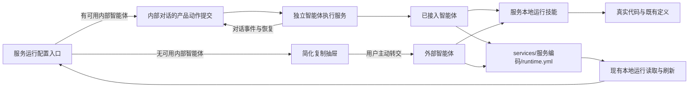

## Context

当前 `AgentDiscoveryDrawer` 同时承担说明、技能规则摘录和全文复制，三个配置入口都只打开这一抽屉。`configurationPrompt.ts` 已能绑定规范工作空间和服务，但重复了 `references/local-services.md` 的大量方法。

内部对话已经具备连接与模型选择、权限偏好、首条请求提交、提交去重、事件流、停止、待回应和恢复；智能体服务由独立执行后台承载。本地运行视图已有五秒刷新、窗口聚焦刷新和写后刷新，运行定义与实例事实不需要另建通知协议。现有对话只支持任务关联，不支持服务关联，但本轮结果权威是服务运行定义，不依赖对话关联才能发现。

## Goals / Non-Goals

**Goals:**

- 用一个配置动作覆盖三个入口，并按实时可用性选择内部执行或复制交接。
- 让产品动作复用内部对话的提交与恢复边界，同时保持对话模块不依赖本地运行业务。
- 让请求与技能分别承载“做什么”和“怎么做”，避免两份方法长期漂移。
- 让人在同一个页面理解是否已执行、当前等待什么、失败后怎样继续，以及最终配置在哪里查看。

**Non-Goals:**

- 不新增运行配置专用执行接口、后台、调度状态或结果数据库。
- 不增加服务与对话的持久关联、历史列表或新的工作对象类型；后续若证明需要，再独立设计。
- 不提供服务命令手填表单，不改变运行定义结构、启动行为或现有实例生命周期。
- 不自动提升权限，不授权远程业务写入，不重画服务目录和对话面板外围布局。

## Decisions

### 1. 职责沿真实产物和执行事实划分



服务运行功能只决定目标、现场身份和交接方式；对话功能负责提交、可见过程和恢复；技能负责调查、验证与保存方法；运行定义继续由本地运行应用读取。不采用“在配置抽屉里再实现一套执行进度”的方案，因为它会复制对话状态、停止与恢复，并让聊天声明容易替代真实配置。

### 2. 在对话上下文提供通用的文本产品动作提交

在 `agent-conversations` 的共享上下文增加与业务无关的首条文本请求能力，输入只包含工作空间、真实工作目录、请求文本及必要的展示上下文。它负责：

- 提交前重新读取连接，按现有记忆选择已启用就绪的智能体、可用模型和工作空间权限；没有可用入口时在创建对话前返回未接入结果。
- 复用现有 `startDraft`、`lookupDraft` 和首条提交身份的去重语义。文本动作不虚构图片草稿，也不另造一套发送协议。
- 提交期间暴露单一进行中状态；已存在尚未核对的首条提交时先恢复原提交，不覆盖其身份。
- 受理后打开对应现有对话；提交结果未知时先查询原提交，只有明确未受理才允许重试，绝不自动转成交付另一条复制请求。

服务运行功能通过本功能内的共享动作或钩子调用该能力，不在三个页面分别拼接请求和处理对话状态。现有对话输入框继续沿用当前手工发送体验；本次抽取只共享确有相同语义的选择与提交原语，避免为接入一个动作重写整个对话面板。

不采用服务运行页面直接调用智能体接口的方案，因为那会绕过连接偏好、权限和提交恢复，也会把业务模块耦合到执行协议。

### 3. 已接入直接执行，未接入才出现复制抽屉

已接入路径不增加确认弹窗：点击“运行配置”本身即表达本次配置和必要本地验证授权。按钮就地显示提交中，受理后关闭原配置抽屉并打开对话；等待、停止、补充要求和执行失败均由对话现有组件表达。

未接入或提交前可用性读取失败时，保留原抽屉位置但重排信息：

1. 标题与服务身份保持不变，首要提示“尚未执行”及原因。
2. 用一段说明和三个短项交代将检查真实代码、验证候选、保存运行定义。
3. 就近说明本次允许本地候选启动、只读验证和运行定义修改，不包括远程业务写入；保存定义不重启既有实例。
4. 请求正文默认收起到“查看完整指令”，主操作只有“复制指令”；复制成功仍只表示已复制，不表示已配置。

该层级减少阅读和滚动，不通过隐藏授权影响换取简短。若已尝试内部提交但结果未知，则打开或恢复对话，不展示这个复制优先的抽屉。

### 4. 请求只保留稳定语义，方法由技能维护

内部执行与复制使用同一生成函数。建议正文如下，动态值按数据引用而不是终端命令插值：

```text
请为以下服务配置或检查本地运行，让我之后能在 Buildr 查看配置并选择代码目录启动。

工作空间：<名称>
规范工作空间根目录：<根目录>
服务编码：<服务编码>
服务名称：<服务名称>

读取并遵循 Buildr Skill 的“服务本地运行”指引（references/local-services.md）。核对服务登记、真实代码和已有定义，验证候选后按差异更新 services/<服务编码>/runtime.yml 并读回。保留已有运行和无关配置，不伪造验证结果。

本次授权配置所需的本地候选启动、只读验证和上述运行定义修改；不包括远程业务写入、部署、共享配置修改或凭证读取。最后简要说明配置、实际验证和剩余缺口。
```

`show`、`worktrees`、命令字段、服务发现、候选隔离、版本保护和恢复等均由技能按需指导，不再进入每次请求。测试保护身份、授权和技能入口，不逐字复制技能条款，也不靠固定字数替代语义完整性。

### 5. 对话和运行定义分别呈现自己的事实

配置请求受理后立即使用现有对话事件流；运行定义继续由现有轮询、聚焦和显式刷新发现。配置动作可以在受理时触发一次静默刷新以清除旧读取，但不根据对话完成事件伪造配置成功。

本轮不增加 `serviceId` 对话关联：服务页面能通过真实定义和对话当前内容完成一次配置闭环，持久服务对话列表属于增量导航价值，不是目标成立的前置条件。也不增加“对话完成即配置完成”的聚合状态。

## Risks / Trade-offs

- [连接状态在读取后变化] → 提交前刷新并由服务端继续校验；失败按是否已经创建或提交分阶段恢复，不静默换通道。
- [默认权限不足以完成候选验证] → 沿用现有对话权限提示和用户控制，不为了“一键”自动扩大权限。
- [未知提交响应导致用户重复执行] → 首条提交身份先持久化，重试先查询；同一配置动作进行中禁止重复提交。
- [只缩短请求后遗漏安全约束] → 规范与测试固定身份、技能入口、验证后保存、已有事实保全和授权边界；详细方法仍在技能中。
- [对话结束与配置可读存在时间差] → 页面显示各自真实状态并沿现有刷新机制收敛，不引入推断性的成功横幅。
- [通用提交能力扩大对话模块改动面] → 只支持文本首条请求，保留现有附件和手工输入路径，分别运行对话与运行配置回归检查。

## Migration Plan

本次仅改变前端交接与请求生成，不迁移数据。既有运行定义、实例、对话和外部复制内容不受影响；旧的长请求不作为长期事实保存。按独立工作树构建并在生产托管页面验证两种接入状态。若需回退，恢复复制优先入口和原请求生成即可，不需要撤销智能体后台或运行定义变更。
