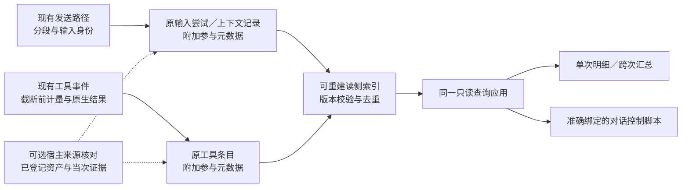

## Context

动机和产品范围见 [proposal.md](proposal.md)。以下现状核对自本任务起点 `c15573079974ac585f96553a9dc09a9f4f265989`，不把历史统计数字作为当前基线。

| 当前事实 | 代码／规范依据 | 对设计的影响 |
|---|---|---|
| 发送前在 `prepare()` 拼接控制指令、交接与用户输入，最终交付点是 `runtime.send()`；预览不等于实际交付 | `services/buildr-agent/src/application/conversation-application.ts` | 在实际提交路径记录分段元数据，沿用输入受理回执；不在预览时增加参与次数 |
| 交互策略由三家适配器通过各自上下文配置交给原生执行器 | `executors/codex/index.ts`、`executors/dsh/index.ts`、`executors/qoder/worker.ts` | 策略配置与每轮文本提交分别计量；沿用原生上下文不等于再次注入 |
| 工具输入、结果、稳定名称和执行归属已进入统一原条目；同一原条目会被更新 | `contracts.ts`、`conversation-application.ts` 的 `applyItem()` | 直接附加元数据，不再建立工具执行日志；按身份而非事件到达次数计数 |
| 原生适配器会先调用 `nativePreview()`，读侧还会再次压缩大条目 | `executors/native-process.ts`、`persistence/conversation-read-model.ts` | 截断前计量；聚合不能使用页面预览长度，也不能承诺原生未上报的完整输出 |
| `contextUsage` 已进入 `runOutcomes`，前端明确“非累计计费用量” | `domain/agent-state.ts`、`ContextUsageSummary.tsx` | 复用保留，不再重复修复；不能按资产相减归因，也不能靠时间序列差值推算账单 |
| Buildr 有来源核对与技能投射身份，但不覆盖所有用户规则和任意命令 | `services/buildr/src/modules/agent-assets/application/source-query.ts`、`persistence/source-object-repository.ts` | 复用已支持的证明，不从当前同名资产追认旧来源；未覆盖项明确未知 |
| 宿主拥有工作空间与业务登记，Agent Service 拥有私有交互；后台不能导入 Buildr 业务模块 | `services/buildr-agent/src/execution-contracts.ts`、`services/buildr/src/modules/agent-service/module.ts`；进行中的 `agent-process-isolation` 规范增量 | 来源解析由可选宿主能力提供，最小宿主无此能力仍能正常执行 |
| DSH 桌面来源规范明确不等于统一参与统计，内部 DSH 适配不代表自动装载桌面插件 | `openspec/specs/dsh-buildr-provenance/spec.md`、内部 DSH 接线 | 只借鉴来源边界；只有实际收到可验证原生来源字段时才消费，不改造桌面生产者 |

所有下文新增类型、文件和入口均为拟议设计，不是现有产品能力。

## Goals / Non-Goals

**Goals：**

- 人和 Agent 能查看同一份执行事实，不阅读整段处理过程也能定位参与项及证据。
- 覆盖三家已接入执行器，协议归一但不伪造能力对等；明确哪些事实完整、部分、未知或未采集。
- 新增状态只保存当次以后无法从原记录重建的元数据；派生索引可以丢弃和重建。
- 观察不改变提示词正文、工具语义、授权、原生恢复、停止或任务结果；本机范围内默认自动采集非正文元数据。

**Non-Goals：**

- 不建设新 Agent 推理循环、另一套工具注册／拦截器、统一操作审计平台或全盘文件访问追踪。
- 不承诺获知厂家最终提示词、隐式规则消费、隐藏工具过程及真实账单分摊。
- 不以读取／调用次数或最终答复自动判断采纳、安全遵循、贡献价值与任务验收。
- 本轮不实现页面或交互原型，不更新当前知识为未来事实。

## Decisions

### 1. 一份原记录，三个采集位置

| 责任主体 | 保存／处理什么 | 不负责什么 |
|---|---|---|
| Agent Service 发送路径 | 本次实际提交的 Buildr 分段摘要、输入身份、交付状态；关联上下文配置摘要 | 不把预览、排队或未确认提交算成已受理 |
| 执行器适配层 | 原生工具输入／可见输出的截断前长度、原生结果证据、实际可取得的来源；将协议差异转成可选字段 | 不按助手文字、stdout 关键词或当前资产推断执行成功 |
| Buildr 宿主来源解析 | 按已核验工作范围和当次定位／摘要确认提供者、身份及版本 | 不复制 Agent 历史，不要求后台导入 Buildr 内部模块 |
| Agent Service 持久化与读侧 | 原记录版本保护、身份去重、可重建索引、单次及聚合查询 | 不写任务、源资产、业务系统状态 |
| Web 与对话控制脚本 | 同一只读结果的展示、筛选和证据导航 | 不扫描源文件补历史，不重新执行命令 |



选择在已有生产边界补元数据，而不在所有 CLI 内部加采集器：前者覆盖已有三家入口，保留原身份，避免新的执行流水、凭据传播与数据库双写责任。工具可能没有完整证据，这是覆盖限制，不用额外拦截业务动作掩盖它。

### 2. 来源、动作、结果分别表达，不做单一“已使用”标志

每项元数据包含以下概念；精确 TypeScript 类型在实施时保持这些语义，不机械复制多套 DTO。

| 概念 | 内容与约束 |
|---|---|
| 原身份 | `sourceId`、执行范围、对话、`runId`、参与者、代次，以及原输入尝试或原条目引用；子调用保留原 `parentToolId` |
| 对象 | `kind` 为 instruction、rule、skill-catalog、skill、capability、cli 或 script；已有稳定 `identity` 优先，名称只用于展示 |
| 来源 | `providedBy` 为 buildr、workspace、external 或 unknown；`managedBy` 单列。来源证据为 confirmed、candidate 或 unknown；candidate 不进入已确认主统计 |
| 版本 | 当次明确读到／提交的内容摘要和证据；只知道供给版本时单列 `offeredVersion`，`observedVersion` 为空，禁止混用 |
| 动作 | 可发现 `available`、实际提交 `submitted`、观察到读取／调用请求 `requested`、有原生证明的读取／加载／调用 `observed`；同一动作的后续状态更新不新增动作 |
| 交付／执行结果 | 交付沿用原受理事实；工具为 succeeded、failed、unknown，尚在执行为 pending；结果和来源独立 |
| 体积 | `utf8Bytes` 和可取得的文本长度、计量边界 native-observed 或 stored-visible、完整性 complete／partial／unknown；没有数据为 null，不填 0 |
| 证据与覆盖 | 原条目／提交引用、可选原文片段、采集版本、局部缺口原因；不保存另一份正文、任意参数或秘密 |

“已提供”是面向人的分组，不是业务执行状态机：可发现列表、上下文配置和实际文本提交分别展示，不能把它们相加冒充模型输入总量。

### 3. 直接提交与沿用上下文的计量边界

在发送装配中保留具名分段，再按原顺序拼接成与改造前一致的正文；对装配结果做字节相等测试。分开标记 Buildr 指令、控制包装、交接包装、用户本次输入、携带的用户历史及附件描述。只有 Buildr 自身片段进入方法体积；其余仅计入“经 Buildr 承载的内容”，不能全算成 Buildr 方法。

在每个实际输入尝试中保存分段种类、摘要、长度、来源和交付引用，不保存拼接全文副本。已有 handoff 原文则引用原记录；未保存历史正文的分段只展示当次摘要和长度，不用当前版本补齐。

交互策略在适配器实际配置／恢复上下文时留一次配置事实，后续轮次引用该事实，并标记“沿用上下文”。`submitted` 只说明交给执行器，原生 accepted 只说明执行器受理，不证明厂家最终把所有文本送进模型。预览、排队、失败和送达未知保持准确原状态。

规则与技能描述清单由宿主提供有界的可发现快照。快照仅证明在该执行范围、运行时和时点可发现，不宣称厂家最终载入。未检查的目录和附属资源不递归扫描；缺少清单或超过预算标记部分覆盖。

### 4. 来源核对复用现有能力，无法证明就降级

- Buildr 直接生成的分段由其实际生产者证明；技能和附属资源优先使用登记、投射回执及当次实际摘要，复用 `source inspect` 的 metadata 语义。
- CLI 不依赖方法名称确认。宿主复用当前安装身份或明确开发入口的权威观察，提供获准入口的准确路径、物理文件身份、内容版本及适用运行范围；字面量请求与该入口证明匹配，才能确认其“请求目标”为 Buildr。仅有 PATH 名称、同名副本或无法证明的 shell 解析时仍为候选，不能声称已启动该程序。既有 `source inspect` 的文件／技能协议不强行承载未支持的 CLI 类型，入口观察由同一可选宿主能力适配，不能另建手工维护白名单。
- 对已确认归属的规则，以执行范围、准确路径／片段和实际摘要区分版本；不强制新建全局规则回执。只有路径时可以记录定位器，但提供者和观察版本仍可未知。
- 当前来源解析只对特定规则区块和登记资产给出证明，不因本任务而把全部 `AGENTS.md` 归为 Buildr。自举规则、客户规则和第三方方法分别归属。
- 宿主通过公开、可选的来源观察能力接收最小定位和实际摘要，后台不读取 Buildr 登记表。能力协商缺失、宿主离线或核对超时只产生局部覆盖缺口。
- 不发送普通用户正文给来源核对器；不为统计再次读取任务说明、资料、数据库结果或凭证文件。
- 来源查询只在当次采集过程中发生。查看、刷新、重建索引和历史分析只能用已存证据，禁止反查当前资产追认历史。

三家适配首版承诺如下，不依赖某一家特有插件：

| 来源 | 可稳定取得 | 不能默认取得 |
|---|---|---|
| Codex | 原生工具／命令输入、条目身份、上报文本长度、原生结果字段、Buildr 自己提交的配置 | 隐式规则加载、命令内部每个子动作的来源与结果 |
| DSH 内部执行 | 原生 call/result、原请求关系、文本长度、错误或未知事实；实际收到合法来源时保全 | 桌面插件生产者已接入、所有加载和子动作均有来源 |
| Qoder | SDK tool_use/tool_result、原身份、输入输出长度及错误事实 | 所有 SDK 消费行为、完整隐式加载、未验证的词元用量 |

原生上报之前已截断的内容，只能作为“原生上报范围完整”，不能称为工具全部输出。

### 5. 工具请求识别保持有用，但不冒充真实进程追踪

对明确 Skill／Read 等原生调用，以及简单字面量 CLI／文件读取请求，使用有界的结构解析；所有命中带解析器版本和原输入引用。解析命令输入，不搜索 stdout、助手文字、引用文档或路径子串。

首版支持可证明的直接命令和解释器＋已确认脚本形式；别名、函数、动态变量、`eval`、生成命令及无法消歧的包装只记候选或未知。不会启动命令、解析任意脚本正文或代替 shell 执行以取得归属。

复合命令中可识别的字面量只能证明“请求中包含该动作”，不能证明条件分支执行。整体工具成功不传播到每个子动作；混合输出留在原工具级，不能平均分摊到多个 Buildr 命令。只有原生子调用身份和结果明确时才能细分。

原生可信退出码或错误回执决定动作结果；普通工具 completed 只代表原工具结束，缺少动作级证据时结果仍为 unknown。读取一段技能不等于加载整份技能；版本必须来自实际观察内容，不拿工具结束后磁盘上的当前文件代替。

### 6. 存储只增加原记录元数据与可重建投影

计划在现有私有对话记录中增加可选的发送／上下文参与字段，在原工具条目增加可选观察字段。保留原 `name/input/text/status`、条目身份和来源映射；观察字段非法或超限时丢弃该附加字段并标缺口，不使本可成功的原条目保存失败。原数据库本身不可写仍沿用既有持久化错误语义。

工具去重键使用已持久原条目身份；发送使用原输入尝试身份；同一工具的开始、流式增量、终态、历史重载更新同一事实。候选升级为确认不新增调用；只有新的原请求身份才增加请求数。原条目后续准确改归属时投影同时迁移，不重复归入旧执行。

跨次统计增加 `ConversationParticipationReadModel`，沿用既有读模型模式：保存原对话修订、采集／解析版本及规范化计数、长度和证据键，不保存正文。原记录是权威，索引缺失、陈旧或构建失败只返回 building／partial／unavailable，不能伪装为零参与。

重建按对话修订有界分批处理，不在每次页面打开时扫描所有大 `body`。旧后台仍在写入的对话通过原修订变化使投影失效；新版重建只读取旧记录已有事实。不同并行兼容级别须证明旧写入者能够保留新字段，否则推迟相应格式启用，不强行宣称双向兼容。

原记录保存成功后只使对应投影失效并安排有界增量更新，复用既有后台调度与变更发现，不新增常驻采集进程或全库轮询。中断后从原修订续建；索引更新失败与原保存成功分别表达，查看不能用旧索引冒充当前结果。

继承历史、交接副本和主／子对话引用只作引用，不产生新的原读取／调用次数。真实子对话新请求按自己的身份计入；没有准确父子关系不按文本相似性猜测。

### 7. 指标先解释事实，不制造单一综合分数

默认按 `(提供者, 对象身份, 已证明版本)` 聚合，未知版本单列，允许用户显式合并版本。时间范围按执行开始时间的半开区间 `[from,to)`；范围、时区、筛选及索引切点随响应返回。

| 指标 | 精确口径 |
|---|---|
| 涉及执行数 | 在选择范围中有该项相应事实的去重执行数；可发现、实际提交、请求和观察分别计数 |
| 请求数／确认动作数 | 原动作身份去重；候选请求和有原生结果的实际动作分栏，不把所有请求统称成功调用 |
| 已知体积 | 可明确归属到该对象、动作和计量边界的长度；完整、部分和未知分开，不含包装、截断提示或混合输出的臆测分配 |
| 失败比例 | `failed / (succeeded + failed)`，仅动作结果已知的样本；pending 和 unknown 单列，分母为零显示不可计算 |
| 重复请求 | 同一执行、同一对象、同一动作、可安全取得的相同参数结构的后续请求；只表示重复，不判定浪费。参数只在内存比较，不另存原参数／秘密摘要 |
| 使用覆盖比例 | 只对同对象／同供给版本且存在可用快照的执行计算 `有请求或观察的执行 / 已确认可用的执行`，同时报告消费观测覆盖；隐式加载不可观测时不得解释为真实使用率 |
| 采集覆盖 | 总执行、已采集、部分、未采集及结果／长度未知数量，和可发现快照完整性分别展示 |

`contextUsage` 保留来源、最近报告值及可取得的时点，仅作执行上下文背景。首版不新增词元估算器，不将字节换成账单，不用总用量减去 Buildr 估算量求“厂家余量”。高体积、高失败、反复帮助查询、低可观察使用覆盖只能形成调查线索，不能触发自动删改。

### 8. 一个查询应用，两个用户视图和按需 Agent 入口

新增只读操作 `conversations.participation`（单轮）与 `conversations.participationSummary`（范围汇总），返回带版本的 `buildr.agent-participation/v1` 与 `buildr.agent-participation-summary/v1`。调用方不能写入标记、任意指定磁盘数据根或发起重新执行。

Web 映射拟采用：

- `GET /api/v1/workspaces/:workspaceId/agent-conversations/:conversationId/runs/:runId/participation`
- `GET /api/v1/app/agent-service/participation-summary?workspaceId=...&from=...&to=...`
- 默认空间的单次入口复用既有 `/api/v1/app/agent-service/conversations/...` 别名。

两类查询通过同一后台应用完成，宿主只认证并解析已登记范围。单次证据正文复用既有 `entry-detail` 的准确版本读取；历史正文缺失时展示元数据及原因，不调用当前文件。摘要响应不返回工具参数、正文、凭据、数据库路径或后台认证。

首版默认最近 7 天、每页 50 行，上限 200 行、单响应 1 MiB；单次汇总窗口最多 90 天，用户可分窗口查看。游标绑定筛选及观察切点；变化时明确要求刷新，不静默混合。这些是拟议查询边界，不是已测性能结论。汇总基于完整选择范围的有效投影，不从当前已加载页面推算总量；未完成投影明确标部分。

界面保持现有全局“对话”和轮次结构：

1. 轮次操作增加“Buildr 参与”，打开同侧明细；分为“已提供”“读取与调用”“未知与缺口”，默认不自动读取所有工具正文。
2. 全局对话入口增加“Buildr 参与汇总”，在同一功能内打开汇总视图，不新建顶层导航。优先沿用明确选中的工作空间；没有明确范围时先选择，不能默认汇总所有空间。`@default` 作为可明确选择的独立范围。
3. 汇总默认列对象、版本、涉及执行数、请求／确认动作数、已知体积、失败／未知和覆盖。按 Agent、模型、种类、对象／版本及时间筛选；选择一行再展开执行列表并定位原证据，保留筛选、滚动、对话选择与未发送草稿。
4. 空结果区分“范围内没有执行”“没有确认项”“尚未采集”“索引未就绪”“读取失败”；运行中标暂定，不显示为完整结果。上下文用量继续沿用“非累计计费用量”说明。

信息分组对应组块化与认知负荷原则：主表只呈现优化判断所需事实，来源细节和正文渐进展开；不增加“参与率／价值分”大卡片，也不假装做过用户研究或页面验收。

Agent 入口在现有准确绑定的 `conversation-control` 脚本增加只读动作：

```text
<本轮已提供的准确控制命令> participation '{"runId":"已核对的执行标识"}'
<本轮已提供的准确控制命令> participation-summary '{"from":"...","to":"..."}'
```

单次动作限定绑定对话，汇总限定其执行范围；不接受替换 workspace/source/dataRoot 或扩大到所有空间。旧运行单元不支持时如实报告，不自动升级、重启或切换执行者。现有 read／observe／stop／link-task 语义保持。

在 Buildr Skill 的内部对话参考中说明何时选择查询、如何核对覆盖和如何据证据提出优化；无准确绑定不猜脚本／端口／凭据，使用已有界面或经宿主认证的调用方能力。首版不新增 `buildr agent ...` 命令组，不把查询方法全文塞进每次控制指令。

### 9. 有界采集、隐私与失败隔离

- 只保存观察元数据和已存在的准确引用，默认本机保留，生命周期随所属原对话，不创建云端上传或额外后台网络发送。
- 当次来源核对每批最多 32 项，复用既有 metadata 输出；可发现快照只覆盖登记入口，不递归读取参考库。来源核对使用最多 250ms 的局部预算，异步且不阻塞工具／发送；暂未完成的标 pending，晚到结果须校验原条目和观察版本。
- 单原工具附加元数据上限 8 KiB、最多 32 个对象匹配；单次供给快照上限 128 KiB。超限保存 partial、数量缺口及原因，不静默丢弃为零，不截断原业务正文。
- 不新增 HOME 副本、环境变量快照、账号信息、秘密参数、SQL 或用户资料正文副本。公开定位器优先工作空间相对路径；完整原参数仍受原工具详情权限约束。
- 批量来源解析和索引任务可取消、让出事件循环，采用现有原记录 CAS 校验；损坏的单项与其他可读项隔离。关闭详情取消正文读取，观察本身不唤醒模型。

选择局部降级而非“来源完整才允许执行”：观察保护的是统计解释，不是业务副作用授权，不能因它失败阻断合法工作。

### 10. 计划结构与关键调用链

以下为职责建议，实施可在相同责任内调整文件粒度，不预建空模块：

```text
services/buildr-agent/src/
  contracts.ts                         兼容公开视图／执行器可选观察字段
  execution-contracts.ts               可选宿主来源能力与协商
  domain/participation.ts              参与语义、去重与纯聚合口径（拟新增）
  application/conversation-application.ts 现有发送／事件接线
  application/participation-query.ts   单次和范围只读应用（拟新增）
  persistence/conversation-repository.ts 原记录保存与版本保护
  persistence/participation-read-model.ts 可重建索引（拟新增）
  executors/{codex,dsh,qoder}/          各自原生计量与证据映射
  process/{operations,conversation-control}.ts 公共只读操作与准确控制入口
services/buildr/src/modules/
  agent-service/                       宿主装配与认证 HTTP 适配
  agent-assets/                        现有来源核对，不转移到 Agent Service
services/buildr-web/src/features/agent-conversations/
  api/agent-conversations-api.ts       已有客户端扩展
  ConversationParticipation*.tsx      单次明细／汇总及局部展示（拟新增）
```

代表调用链：

- 提交 → 原输入尝试 → 分段计量 → 原生提交／受理更新 → 原记录元数据 → 读侧投影。
- 原工具输入／结果 → 厂商适配器截断前计量 → `applyItem()` 同身份更新 → 可选同期来源核对 → 原条目及投影。
- Web／准确控制入口 → 公共 operations → 查询应用 → 读侧切点 → 有界摘要／原证据引用；不回到采集入口。

## Risks / Trade-offs

| 风险／代价 | 处理 |
|---|---|
| 同名 CLI、shell 条件和混合输出造成误归属 | 输入结构解析＋来源证明；请求和实际结果分开；候选、混合输出不进入已确认资产体积 |
| 规则隐式加载无消费信号 | 提供可发现记录与明确盲区，不为“统一”制造加载事件；不凭低观察率建议删除 |
| 当时内容变化、当前投射或用户段混入 | 提供者和摘要分别证明；仅记录实际片段，未知版本单列，查询不反查 |
| 附加记录增长与统计扫描拖慢执行 | 不复制正文，元数据上限、分批索引、只读分页、超时取消；实施时测量而非承诺零开销 |
| 并行后台／重载导致重复或丢失元数据 | 原身份与修订去重；旧写入保全测试、索引失效检测；不通过强停解决兼容性 |
| 来源核对依赖暂时离线宿主 | 可选、异步、局部预算；缺口显式可见，原执行照常 |
| 用户把调用量当成价值、把文本体积当费用 | 指标分栏与固定说明，无综合评分和自动优化；优化后仍需按原目标验收 |
| 观察动作观察自己形成反馈 | 查询不产生模型或业务调用；若 Agent 主动通过 shell 查询，最多按原真实工具记录一次查询请求，不递归采集查询响应中的命令与路径 |

## Migration Plan

按三个可验证里程碑推进，具体动作见 [tasks.md](tasks.md)；本轮不执行这些实施动作。

1. **M1 自动标记和保存**：公共可选字段、三家适配和原记录保存；完成有界元数据及重启／兼容测试，先建立可信样本。
2. **M2 同一查询与汇总**：单次查询、可重建索引、准确统计和只读 HTTP／控制入口；历史只展示已有事实与未采集范围。
3. **M3 人与 Agent 可用**：单次明细和汇总界面、按需技能指引、隔离场景验证、性能证据、知识校准及必要验证登记。

升级只对新发生的事件自动采集。旧记录缺字段保持未采集；可以重建它们已有的派生索引，但不重新鉴定来源。用户正常使用不需要补建任务、点击开启采集或重新发送历史指令。

退出新版本时保留原记录和元数据，仅在已证明原私有格式及并行兼容时使用旧运行单元；不兼容则保留数据、停止相关版本回退，不改写原记录。新观察能力可不再采集或暂不展示，不能为回退删除旧历史或恢复被省略的业务动作。

未来交付后的自举激活仍由既有唯一执行器负责，本方案不新增同步／安装路径。实际发布另需明确授权。

### 验收与优化基线

- 使用隔离数据构造“三次同对象请求、一次失败、一次未知”、开始／结果重复投递、主子引用、复合 shell、隐式规则、用户资料、截断及宿主离线等可确定预期的样本；不得把样本数字写成客户真实使用统计。
- 三家各取得真实执行样本，分别证明原生字段→保存→重启读取→单次明细→汇总的链路；无法取得的一家保留覆盖缺口，不外推其他家测试。
- 测量开关观察前后的相同工作负载：发送附加时延、每工具额外写入字节、索引构建与分页查询时延、页面请求量和取消行为。以固定夹具的结果正确、预算执行和无明显主线回归作为首版依据，不先设没有基线的普遍收益百分比。
- 当前知识影响评估（assess）：`knowledge/docs/architecture/agent-integration.md` 需补真实观察入口和计量边界；`agent-boundaries.md` 需补厂家不可见与不推断价值；`knowledge/code-map/technical-layers.md` 需补实际新增职责及调用链。现有系统／SQLite 图只有在最终跨服务或实体关系确实变化时才更新，本轮不新建长期图。
- 术语沿用现有“来源、执行、上下文、技能、能力”，新增指标在本能力内定义，不启动长期术语改名。最终知识维护按实际实施成果和对应授权接续，不能用规划文档替代当前知识。

### 兼容实现校准

工具观察附着在原私有对话记录的 `participationTools` 字段，以原工具条目 ID 为键；原公开条目的 `name/input/text/status` 和旧详情 DTO 形状不变。原生执行器仍通过可选参与字段交付观察，保存时在同一记录内归位；新增只读查询从该关联投影事实。这样旧严格响应校验不会因未知字段拒绝读取，旧 JSON 写入者保留可选根字段；不新增正文副本、独立事件表或第二执行流水。索引依旧以原对话修订为准，可重建。
