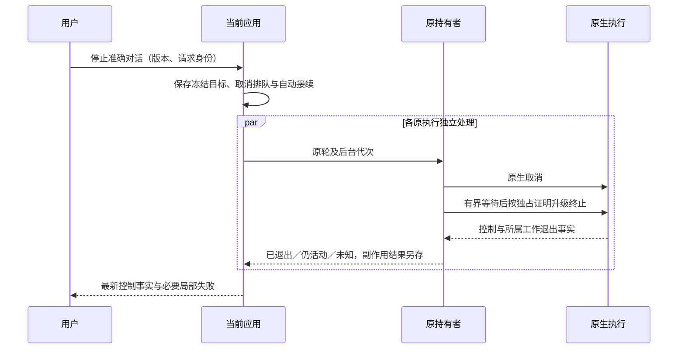

## Context

动机与范围见 [proposal.md](proposal.md)。规范已有“整轮停止必须覆盖准确派生工作”，允许按独占所有权受控终止；本变更补足对话级聚合，不能把已有终止缺陷重新解释为原生不可控。

直接观察的实现：

- 前端 `conversation-stop.ts` 的恢复逻辑固定 `conversation.run`；`ConversationPanel.tsx` 在当前轮 `resourcesReleased` 时直接返回，冻结输出也只有一个 `runId`。保留轮另有单项入口。
- 进程路由 `server.ts` 按控制输入中的 `generation` 转发单项停止；应用 `stopOwned` 保存单轮意图，并调用适配器停止。
- Qoder CN `stop` 只对尚在 `pending` 的轮发送一次 `session/cancel`，等待最多 5 秒后返回观察；`send` 在 `supplementFailed` 时将状态覆盖为 `unknown`。本案例旧轮已经有停止意图，没有未完成工具，但缺少退出证明，不能据此断言仍在执行或全部已停。
- `PendingSends.pump` 会自动认领和投递已保存输入，与原生内部追加队列是两个不同边界。
- ACP 客户端持有准确 `ChildProcess`，其 `close` 调用 `closeOwnedProcess`；这个能力只证明控制子进程退出，不天然证明所有派生工具退出。已有 `OwnedControlResource` 提供执行绑定与资源组核验思路，不能把冷恢复的历史 PID 当作当前所有权。

## Goals / Non-Goals

**Goals：** 一次用户操作形成可恢复且范围固定的停止；局部失败不拖住其他目标；副作用未知不再等同运行；全部需要停止的工作确实经过终止核验。

**Non-Goals：** 不做机器级清场，不自动提交任务成果，不代答授权，不重放历史输入，不删除会话或账号，不接管其他活跃任务的候选补丁。

## Decisions

### 1. 聚合由服务负责，精确控制由原持有者负责

| 层 | 职责 |
|---|---|
| 前端主入口 | 提交准确对话、观察版本及稳定停止请求身份，展示汇总与局部未停项 |
| 当前应用 | 原子确定停止目标和未开始输入，保存意图，禁止目标自动续行 |
| 进程路由 | 根据每项目标的原后台代次分发，不把旧原生控制句柄转给新适配器 |
| 原持有者与适配器 | 停模型、追加队列、工具和派生树；必要时升级终止并返回退出证据 |

选择新增明确的对话级动作，保留现有单轮/单工具动作兼容。不能让浏览器遍历 `retainedRuns` 充当唯一编排者：页面断开会中断清理，多个版本和队列认领竞态也不由浏览器保护。CLI/智能体控制须能使用同一聚合动作；既有 `stop` 的准确单轮语义不悄悄扩张。

### 2. 用最小持久停止范围解决队列竞态

复用对话原有尝试、停止意图和待发送记录，补足一个请求身份对应的冻结目标集合及待取消输入身份，不建立全局工作流或重复的执行状态库。停止受理必须与目标自动调度禁止、未开始输入取消形成受保护的写入边界；队列认领后还必须在实际发送前核对停止范围。

若发送已经越过可取消边界，不能假称“未交付”；原请求身份继续保留，迟到 `accepted` 回调将其准确原轮纳入停止，禁止再次投递。停止之后显式提交的新请求有自己的身份，不属于这份冻结目标。传输结果未知先按停止请求身份读取，不盲目创建第二份停止。

### 3. 终止升级必须有所有权，不能只关闭连接

沿用原生中断优先。Qoder CN 的原生等待超过现有 5 秒预算仍未结算时，原持有者以准确上下文、执行绑定和自己持有的活体子进程为依据终止独占资源。控制通道已经失效但仍持有活体资源时，同样需要可核验的关闭与退出路径；不能因 `transportClosed` 提前返回而漏清理。受管资源组或工具身份仍须独立核对，后台派生工作不能因父进程退出自动记为结束。

不采用无限重发 `session/cancel`，不按 `qoder` 等程序名批量杀进程，不停止共享 Agent Service。冷恢复没有活体所有权或原工具身份时，保留准确未知并允许独立工作继续；不能为消除提醒伪造退出。Codex、DSH、Qoder 各自使用其准确原生工具及派生工作控制，不能把 Qoder CN 的子进程处理机械复制到共享原生后台。

### 4. 结束事实与操作结果分别保存

优先消费适配器已有的 `executionState`、控制释放及工具观察，必要扩展也应只表达缺少的退出证据。`supplementFailed` 继续保护送达未知，不能无条件覆盖已经证明的执行结束。被终止的工具不记为成功，缺失回执的外部操作不重发。全部已退出后，活动列表和主按钮不再因历史未知声称“还在跑”。

前端将单轮冻结扩展为目标轮集合；停止请求失败、未受理、部分停止和退出未知分别显示。当前轮已结束但旧轮仍待停时，主入口仍可用。停止后新轮不继承旧轮的冻结状态。

### 5. 与现有规范及相邻工作兼容

现有整轮停止、准确派生树控制和“停止未确认时的显式继续出口”继续有效；新增对话级主入口不收窄单项 API 的既有契约。普通新要求不是停止，也不因本变更默认杀旧工作。

`qoder-cn-supplement-durable-receipt` 和 `qoder-cn-stop-settlement` 由原执行承担；本阶段只基于已集成源码设计。实施前重新读取其实际交付，不把活动候选当成已上线，也不在同一文件并发接手。

## Risks / Trade-offs

- [停止范围扩大] → 主按钮及可访问名称明确为“停止对话”，单项入口保持准确语义；未提交草稿和后来显式要求保留。
- [某原后台离线拖住全部停止] → 各项并发、有限期限独立结算；前台及时返回受理和局部状态，清理归后台持有。
- [重复请求或流式版本冲突] → 只对明确未受理的版本拒绝重新观察；已受理按原请求查结果，不自动追杀替换轮。
- [受控终止留下工具或外部副作用] → 核对所属工具及派生树，不把进程退出当全部完成，副作用未知继续保留。
- [只改活动标签掩盖执行] → 测试须观察真实夹具子进程和派生工作，而不是只断言 `status` 字符串。

## Migration Plan

1. 在任务隔离位置扩展对话级公开操作、持久停止范围和聚合控制，保持单项契约；同步进程操作、宿主路由及客户端类型。
2. 补足适配器终止与退出证明，优先覆盖本案例 Qoder CN 取消和追加失败路径；执行跨厂家控制回归。
3. 切换前端主入口及随包操作指引，保留历史数据和原未知结果，不执行历史批量停止。
4. 候选验证后按已授权交付流程集成；正式自举激活只交给唯一执行器，不从候选目录更新共享运行时。
5. 回退时停止新聚合请求，保留已保存的取消意图与未知结果，不能用降级恢复已取消的工作；未知数据兼容性必须先核对，不覆盖私有数据库。
