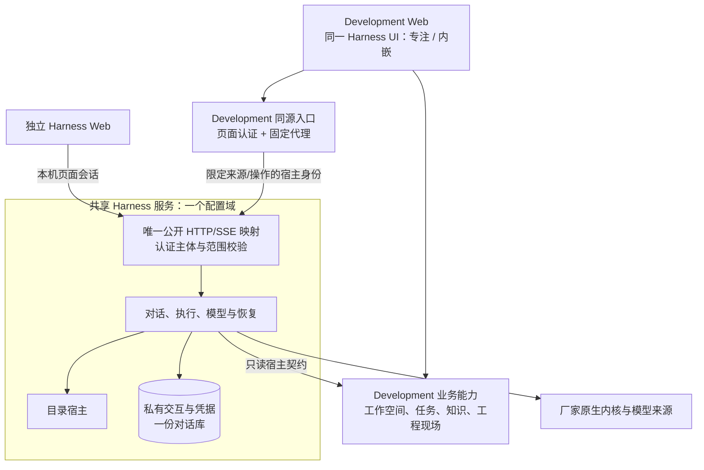

## Context

前置核心/API 见 [第一变更](../split-buildr-harness-product/design.md)。现有 `ConversationPanel` 仍直接引用 code API 和路由，`conversation-association-client` 调用任务/空间 API，`TaskConversationEntry` 依赖工作页面上下文；`AgentConversationsProvider` 已允许注入客户端。抽包应沿这些真实边界进行，而不是按行数机械移动。

现有后台的 `adoptParallel` 允许两代并存；网页会话目前属于 Development Web 进程。将独立监听直接塞入后台而不设计交接，会争抢端口、丢登录或令旧代次永久承担网页。

## Goals / Non-Goals

交付一个完整功能包、一个独立薄壳及 Development 两模式；同页切换保留对话、草稿和阅读位置。独立网页可在候选负载中使用，但可安装发行包和真实产品启动器由第三变更交付。本变更不制作新原型、不引入 iframe、微前端、跨窗口草稿协同或新任务系统。

后续 DSH 插件只作为可替换承载的设计方向，不在本变更验证或实现；也不新增工作概览、自动摘要、通用工作环境选择器或行业界面。“工程工作环境”表达 Development 的能力归属，不增加一套模式交互。

## Decisions

### D1. 完整功能归 Harness，Development 仅集成工程现场

| 能力 | Harness 功能包统一负责 | Development 仅负责 |
| --- | --- | --- |
| 对话导航、列表、搜索、历史与运行/待回应状态 | 完整界面、查询编排与交互 | 提供准确工作范围、任务引用或筛选条件 |
| 消息、流式输出、工具过程与结果 | 渲染、增量处理、历史加载及错误反馈 | 不重复实现 |
| 输入、文件/图片材料、发送与待发送内容 | 编辑、附件生命周期、发送/排队状态与失败恢复交互 | 取得用户明确选中的任务、文档、代码或文件材料 |
| 内核、模型、账号与权限选择 | 选择器、兼容提示及当前选择状态 | 不维护第二套模型或权限选择逻辑 |
| 问题、审批、停止与接续 | 完整卡片、校验反馈、准确控制调用与交互状态 | 不重写答复、审批、停止或恢复控制器 |
| 内核连接、订阅/BYOK 与相关程序设置 | 完整设置面板、表单、验证反馈与状态读取 | 提供设置入口，不复制表单或接线 |
| 数据订阅、缓存、重连与冲突反馈 | 使用 Harness 公共客户端统一编排，维护局部对话状态 | 注入当前 origin 的认证/传输适配，不另写事件合并和恢复循环 |
| 工程现场 | 提供打开/创建对话、添加材料及受限附加区域 | 任务页入口、工作空间选择、任务关联控件、文件/成果导航、返回现场 |
| 布局与主题 | 提供能适应尺寸的完整对话区域及设置界面 | 决定停靠位置、并排布局、专注切换和产品外壳 |

共享功能提供高层 `HarnessSurface` 和完整设置面板，而不是要求宿主拼几十个控件。Development 的对话集成代码限定为入口布局、业务上下文、业务动作；通过具名窄接口提供范围、明确选中材料、任务附加区、文件打开和业务导航。它不接管发送/控制状态机、事件合并、重连或账号表单。

Development 的任务、知识和代码等业务页面不要求 Harness Provider 才能读取自身事实，Harness 挂载点及其适配由接入层维护。共享 Harness UI 同样不依赖独立应用壳或 DSH 插件装载上下文；只使用明确的客户端与窄宿主能力。本次用现有两产品组合和无业务宿主夹具证明边界，不建设第二个执行提供方。未来直接使用 DSH 原生对话的 Development 装配可采用宿主界面，不因本次三形态共用 UI 而被迫加载 Harness；那条交付路径不属于本次验收。

另需区分未来的 DSH 生态完整组合：DSH 插件框架承载 Buildr Harness 与 Development 时，对话、交互及编排仍由 Harness 统一提供，不退回由 DSH 原生对话接管。这条路线复用 Harness 完整功能，Development 或营销等环境只贡献专业能力与适配；DSH 承载适配及新的专业环境均不在本次实现范围。

能力按实际执行器声明显示。内嵌可把历史、搜索和设置收进抽屉，但不是简化实现；独立壳用目录选择和通用文件预览替代工程导航；专注模式保留来源及返回现场入口。无任务能力时不显示失效任务页。业务对象核验仍在服务器。

| 工程单元 | 责任 |
| --- | --- |
| `services/buildr-harness-ui/` | 完整功能、设置、客户端订阅和交互状态 |
| `services/buildr-harness-web/` | 独立薄壳和正式静态构建 |
| `services/buildr-web/` | Development 业务前端、布局和窄适配 |
| `services/buildr-agent/` | 前置唯一 API，加可选网页承载与认证发现 |

通用组件按真实复用选唯一所有者，不为对称搬走全部 `components/`。同一仓库、工作空间和 Product Project 继续开发所有单元；分别登记构建测试，不建第二套任务库。

### D2. 渐进抽取，每片回接 Development

顺序为：历史只读及流订阅 → 输入/附件/发送/队列 → 问题/审批/停止/接续 → 连接/模型/订阅/BYOK/程序接入设置。每片同时交付公开界面、薄宿主夹具、Development 回接和回归测试；旧实现退出该片权威后再做下一片，不保留两套长期逻辑。订阅和缓存随第一片建立，后续能力继续复用，不留到最后集中重写状态。

共享源码采用构建时包依赖；两个网页各有运行内存，不共享同一 React Provider。Development 页面内 Provider 与对话状态不随专注/内嵌布局销毁；缓存含数据域/来源/对话，事件另校验代次及游标。跨窗口只共享持久事实，本地未提交文字各自保留。

边界验收：共同消息/模型/停止行为修复只改 Harness，两个消费者升级重建后生效；新增工程成果页面才需要 Development 增加打开/引用适配。Development 单次生成提交说明的业务草稿所有权仍保留，不把它扩成另一对话实现。

### D3. 一个逻辑后台，两个可选产品 origin

保留 Development 自己的业务 Web；内嵌和专注始终只请求该 origin。只使用 Development 时，独立 Harness 网页监听默认关闭。显式打开独立 Harness 时，由同一协调后台启用一个回环网页监听和完整独立壳；两产品同开可以有两个 origin，但只有一份执行服务和资料。

这是对旧“不得要求额外网页端口”的精确区分：Development 仍无需第二浏览器端口，新增的独立产品允许自己的显式入口。选择这一方案，而不是同装时强制 Harness 借 Development 托管，可使独立页面不依赖 Development 是否运行。不是依靠“默认不监听”回避同开情形，也不另起常驻 Web broker。内部 IPC/网关端口不对浏览器开放。

### D4. 网页监听归当前协调代次，地址和会话归逻辑服务

网页端点记录属于 `dataRoot/profileId` 下的私有控制资料，保存稳定端点身份、地址及当前持有代次。首次由操作系统分配可用回环端口并保存，之后包括升级重启均复用；不硬编码或抢占 Development 的 4457/4458。只有通过实例身份、认证探针及监听就绪观察后才发布可用地址。

兼容换代流程：

1. 先检查候选 API、存储、页面会话格式及保留静态资源兼容性；执行后台按前置的唯一激活流程准备新版。
2. 原公开监听进入有界排空，不受理新的未知写入；关闭 SSE 让客户端按游标重连，保留原请求查询身份。
3. 以准确端点/持有者/代次及版本保护释放监听权；旧进程保留私有 IPC 和原轮，不再保留公开监听。
4. 新协调代次取得监听权、在同一地址绑定，完成探针后发布新的端点观察；准确旧轮控制仍路由旧持有者。
5. 失败只恢复能够证明归属与兼容的入口。旧释放未知或新监听可能仍存活时不强占、不双开；网页报告局部不可用，不能把核心已就绪冒充网页已就绪。

允许短暂重连，不承诺零停顿。若私有服务已完成安全换代而网页绑定失败，Development 的可用代理及原执行不被回滚连带停止。网页兼容性不满足时保留当前可用版本，直到可安全交接，不通过新 origin 绕过检查。

页面会话签发/校验材料、到期和撤销状态由逻辑服务私有保存，兼容换代不重置；它与每代后台主令牌、Development 页面身份完全分开。旧页面会引用带内容摘要的资源，必须在声明的页面兼容窗口保留相应静态资源和 API，过期时提示刷新并先保全草稿；不能只保存 HTML 却让旧脚本 404。

### D5. 启动发现、登录与同机 origin 安全

启动入口调用 Harness 公共启动能力，再通过受保护 IPC 获取独立网页 ready 观察。确认产品/配置域/端点身份后签发短时单次票据（建议 60 秒），只用于兑换该入口的页面会话。票据放 URL fragment 而非 query，页面取出后立即清除地址内容并同源兑换；禁止第三方资源、日志记录或传播票据。后台主令牌、模型秘密和宿主凭据始终不进浏览器。

重复点击复用同一端点；已有合法页面会话可继续，过期票据重新获取不重发业务请求。Host、Origin、写入来源与服务端认证都核验。不同回环端口的 Cookie 不是隔离边界，因此独立会话及图片会话按产品/配置域/端点独立命名和路径管理，不与 Development 的 `buildr-image` 共用；不把 SameSite 或端口差异当权限证明。程序 Bearer 不可兑换页面管理会话。

文件打开/预览使用有限类型和路径核验，不拼接任意 shell 命令。Development 文件动作走自身代码面板，独立入口不复制 IDE。

## Risks / Trade-offs

- 移动组件却仍由宿主编排核心 → 四片分别用薄夹具和 Development 回接证明完整性，静态检查阻止私有反向依赖。
- 新旧代次争网页端口或 Cookie 跨端口混用 → 唯一监听权、就绪发布与失败注入；独立会话加 Host/Origin 检查。
- 换代导致旧资源失效、流中断后重发 → 保留兼容资源、重连只读恢复、准确请求查询，测试回执丢失。
- 凭据和 CWD 被误当业务权威 → 沿前置来源/动作授权，独立页面显示原来源及离线限制。

## Migration Plan

前置核心/API 可用后按 D2 四片回接，再装配独立壳和 Development 两模式，最后加入独立监听交接。每片可回退到兼容 API 上的上一 UI 版本，不迁移真实对话库；撤下独立入口不停止核心工作。

退出验证覆盖：三种形态全部功能可达；同页模式切换草稿/滚动/CWD 不变；两窗口并发答复仅消费一次；Development 离线时独立入口历史和精确控制可用；双代次升级维持地址/有效登录/旧轮控制；端口占用、换代中断、会话撤销和跨端口伪造被拒绝。用正式静态产物验证，不用 Vite 通过代替。

知识影响：前端职责、`technical.md`、服务/技术层代码地图、系统图和 Agent 对话使用说明，按实现更新；不同产品页面与共同执行服务必须分别表达。真实供应商测试按实际新增路径选代表集，有授权时执行；缺账号保留未验证事实，不用替身宣称原生支持或阻止无关 UI 验证。
